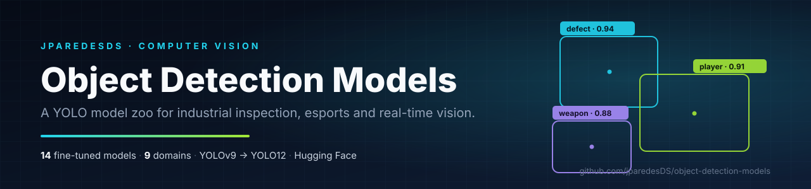

<div align="center">



# Object Detection Models

**Un model zoo de detectores de objetos basados en YOLO para inspección industrial, esports y visión por computador en tiempo real.**

[](https://huggingface.co/jparedesDS)
[](https://github.com/ultralytics/ultralytics)
[](https://www.python.org/)
[](LICENSE)
[](https://github.com/jparedesDS/object-detection-models/stargazers)

[Model Zoo](#-model-zoo) · [Proyectos](#-proyectos) · [Inicio rápido](#-inicio-rápido) · [Herramientas](#-herramientas-de-entrenamiento-y-etiquetado) · [Documentación](docs/) · [Portfolio](https://www.jparedesds.com) · [English](README.md)

</div>

---

## Por qué este repositorio

Este es el punto de entrada único a todos los modelos de detección de objetos que entreno y publico. En lugar de repartir pesos, métricas y notebooks entre una docena de repositorios, todo queda consolidado aquí:

- **14 detectores entrenados** en **9 dominios reales**.
- Arquitecturas **YOLOv9, YOLOv10, YOLO11 y YOLO12**, totalmente compatibles con [Ultralytics](https://github.com/ultralytics/ultralytics).
- **Pesos y model cards** publicados en [Hugging Face](https://huggingface.co/jparedesDS).
- **Notebooks de entrenamiento reproducibles**, herramientas de dataset y ejemplos de inferencia.
- **Métricas honestas**: precisión, recall, mAP@50 y mAP@50-95 para cada modelo del que se conservan registros.

Los proyectos cubren dos mundos muy distintos — ensayos no destructivos industriales y visión por computador para esports en tiempo real — usando el mismo pipeline de entrenamiento, validación y etiquetado.

---

## 🧠 Model Zoo

### Inspección industrial y ensayos no destructivos

| Modelo | Arquitectura | Tarea | Clases | mAP@50 | mAP@50-95 | Enlaces |
|---|---|---|:---:|:---:|:---:|---|
| **Detección de defectos de soldadura** | YOLO11x | Inspección de cordones de soldadura | 4 | **0.842** | **0.632** | [HF](https://huggingface.co/jparedesDS/welding-defects-detection) · [Docs](projects/welding-defects-detection/) |
| **Inspección por líquidos penetrantes** | YOLO11l | Ensayo de líquidos penetrantes (FPI/PT/LPI) | 1 | **0.793** | **0.379** | [HF](https://huggingface.co/jparedesDS/fluorescent-penetrant-inspection) · [Docs](projects/fluorescent-penetrant-inspection/) |

### Esports y videojuegos

| Modelo | Arquitectura | Tarea | Clases | mAP@50 | mAP@50-95 | Enlaces |
|---|---|---|:---:|:---:|:---:|---|
| **CS2 Jugadores · YOLOv9c** | YOLOv9c | Detección de cuerpo y cabeza en CS2 | 4 | — | — | [HF](https://huggingface.co/jparedesDS/cs2-yolov9c) · [Docs](projects/cs2-players-detection/) |
| **CS2 Jugadores · YOLOv10s** | YOLOv10s | Detección de cuerpo y cabeza en CS2 | 4 | **0.979** | **0.772** | [HF](https://huggingface.co/jparedesDS/cs2-yolov10s) · [Docs](projects/cs2-players-detection/) |
| **CS2 Jugadores · YOLOv10m** | YOLOv10m | Detección de cuerpo y cabeza en CS2 | 4 | — | — | [HF](https://huggingface.co/jparedesDS/cs2-yolov10m) · [Docs](projects/cs2-players-detection/) |
| **CS2 Jugadores · YOLOv10b** | YOLOv10b | Detección de cuerpo y cabeza en CS2 | 4 | **0.850** | **0.635** | [HF](https://huggingface.co/jparedesDS/cs2-yolov10b) · [Docs](projects/cs2-players-detection/) |
| **CS2 Jugadores · YOLO12s** | YOLO12s | Detección de cuerpo y cabeza en CS2 | 4 | **0.717** | **0.453** | [HF](https://huggingface.co/jparedesDS/cs2_yolo12s) · [Docs](projects/cs2-players-detection/) |
| **CS2 Armas · YOLO12m** | YOLO12m | Clasificación de armas de CS2 | 19 | **0.993** | **0.871** | [HF](https://huggingface.co/jparedesDS/cs2-yolo12m-weapon-detection) · [Docs](projects/cs2-weapon-detection/) |
| **Valorant Jugadores · YOLOv10b** | YOLOv10b | Detección de cuerpo y cabeza en Valorant | 2 | **0.925** | **0.631** | [HF](https://huggingface.co/jparedesDS/valorant-yolov10b) · [Docs](projects/valorant-players-detection/) |
| **Valorant Jugadores · YOLO11m** | YOLO11m | Detección de cuerpo y cabeza en Valorant | 2 | **0.931** | **0.655** | [HF](https://huggingface.co/jparedesDS/valorant-yolo11m) · [Docs](projects/valorant-players-detection/) |
| **Deadlock Jugadores · YOLO11l** | YOLO11l | Detección de eventos de combate en Deadlock | 4 | **0.856** | **0.486** | [HF](https://huggingface.co/jparedesDS/deadlock-yolo11l) · [Docs](projects/deadlock-players-detection/) |
| **Overwatch 2 · YOLO11m** | YOLO11m | Detección de cabezas en OW2 | 1 | **0.660** | **0.317** | [HF](https://huggingface.co/jparedesDS/ow2-yolo11m) · [Docs](projects/overwatch2-players-detection/) |
| **Fortnite · YOLO11m** | YOLO11m | Detección de jugador y cabeza en Fortnite | 2 | **0.828** | **0.668** | [HF](https://huggingface.co/jparedesDS/fortnite-yolo11m) · [Docs](projects/fortnite-players-detection/) |
| **League of Legends · YOLO11m** | YOLO11m | Seguimiento de campeones en el minimapa | 167 | **0.993** | **0.970** | [HF](https://huggingface.co/jparedesDS/lol-map-tracking-object-detection) · [Docs](projects/league-of-legends-tracking/) |

> **Cómo leer las métricas.** Las puntuaciones provienen de `model.val()` de Ultralytics sobre el split de validación de cada proyecto, con umbrales IoU de estilo COCO. **No son directamente comparables entre proyectos** porque los datasets, las clases y los splits son distintos. Un guion significa que la métrica no se publicó para ese checkpoint; la model card es la fuente de verdad.
>
> Algunos repositorios de Hugging Face están **restringidos (gated)**. Abre la model card y solicita acceso antes de descargar los pesos.

El catálogo detallado con parámetros, GFLOPs, nombres de archivo de pesos y listas de clases está en **[docs/model-zoo.md](docs/model-zoo.md)**.

---

## 📂 Proyectos

| Proyecto | Dominio | Modelos | Destacado |
|---|---|:---:|---|
| [**Detección de jugadores CS2**](projects/cs2-players-detection/) | Counter-Strike 2 | 5 | YOLOv9c → YOLO12s · clases cuerpo y cabeza · notebook de entrenamiento |
| [**Detección de armas CS2**](projects/cs2-weapon-detection/) | Counter-Strike 2 | 1 | 19 clases de armas · mAP@50 **0.993** |
| [**Detección de jugadores Valorant**](projects/valorant-players-detection/) | Valorant | 2 | Clases cuerpo y cabeza · YOLOv10b / YOLO11m |
| [**Detección de jugadores Deadlock**](projects/deadlock-players-detection/) | Deadlock | 1 | Eventos enemy, minion, hit y deny |
| [**Detección de jugadores Fortnite**](projects/fortnite-players-detection/) | Fortnite | 1 | Jugador y cabeza · el modelo con más likes |
| [**Detección en Overwatch 2**](projects/overwatch2-players-detection/) | Overwatch 2 | 1 | Detector centrado en cabeza |
| [**Seguimiento en League of Legends**](projects/league-of-legends-tracking/) | League of Legends | 1 | 167 clases de campeones · seguimiento en minimapa |
| [**Detección de defectos de soldadura**](projects/welding-defects-detection/) | NDT industrial | 1 | Defecto, cordón, pieza y porosidad · notebook de entrenamiento |
| [**Inspección por líquidos penetrantes**](projects/fluorescent-penetrant-inspection/) | NDT industrial | 1 | Detección de defectos (FPI / PT / LPI) |

---

## 🚀 Inicio rápido

### 1. Instala las dependencias

```bash
git clone https://github.com/jparedesDS/object-detection-models.git
cd object-detection-models
pip install -r requirements.txt
```

### 2. Descarga un modelo desde Hugging Face

```bash
# Ejemplo: detector de jugadores de CS2 (YOLOv10s)
hf download jparedesDS/cs2-yolov10s cs2_yolov10s.pt --local-dir weights
```

> `hf` viene incluido con `huggingface_hub` ≥ 0.24. En instalaciones antiguas usa `huggingface-cli download`.
> Si el repositorio está restringido, acepta las condiciones en su model card y ejecuta `hf auth login`.

### 3. Ejecuta la inferencia

```python
from ultralytics import YOLO

model = YOLO("weights/cs2_yolov10s.pt")

results = model.predict(
    source="imagen.jpg",
    conf=0.25,
    save=True,
    device=0,          # "cpu" si no tienes GPU
)
```

### 4. Vídeo, webcam o captura de pantalla

```python
# Archivo de vídeo o webcam (source=0)
model.predict(source="clip.mp4", stream=True, save=True)
```

Para captura de pantalla en tiempo real, consulta [`examples/screen_inference.py`](examples/screen_inference.py):

```bash
python examples/screen_inference.py --model weights/ow2-yolo11m.pt
```

Cada README de proyecto incluye el nombre exacto del archivo de pesos y la lista de clases de sus modelos.

---

## 🗂 Estructura del repositorio

```text
object-detection-models/
├── assets/                  # Banner y recursos compartidos
├── docs/                    # Catálogo de modelos y guías de entrenamiento/etiquetado
├── examples/                # Ejemplos de inferencia (captura de pantalla, vídeo)
├── notebooks/               # Guía completa de entrenamiento YOLO
├── tools/
│   ├── annotations/         # Pseudo-etiquetado, auditoría, remapeo y splits
│   └── augmentation/        # Aumento offline con OpenCV
└── projects/
    ├── cs2-players-detection/
    ├── cs2-weapon-detection/
    ├── valorant-players-detection/
    ├── deadlock-players-detection/
    ├── fortnite-players-detection/
    ├── overwatch2-players-detection/
    ├── league-of-legends-tracking/
    ├── welding-defects-detection/
    └── fluorescent-penetrant-inspection/
        ├── README.md        # Model card, etiquetas, métricas y uso
        ├── assets/          # Curvas, matrices de confusión y predicciones
        └── notebooks/       # Notebook de entrenamiento (opcional)
```

---

## 🛠 Herramientas de entrenamiento y etiquetado

El directorio `tools/` contiene las utilidades usadas para construir estos datasets. Son scripts prácticos: ábrelos, ajusta las rutas de la cabecera y ejecútalos.

| Herramienta | Qué hace |
|---|---|
| [`auto_label.py`](tools/annotations/auto_label.py) | Genera pseudo-etiquetas YOLO para imágenes sin etiquetar con un modelo entrenado; aparta las imágenes sin detecciones. |
| [`check_labels.py`](tools/annotations/check_labels.py) | Audita un dataset: instancias por clase y número de imágenes de fondo. |
| [`remap_labels.py`](tools/annotations/remap_labels.py) | Remapea o fusiona IDs de clase en todos los `.txt` de un directorio. |
| [`split_train_val.py`](tools/annotations/split_train_val.py) | Divide un dataset plano de imágenes/etiquetas en train y validación. |
| [`move_split_files.py`](tools/annotations/move_split_files.py) | Distribuye imágenes y etiquetas aumentadas en carpetas de train/validación. |
| [`move_labels.py`](tools/annotations/move_labels.py) | Reúne los archivos de etiquetas en el directorio canónico `labels/`. |
| [`augment_dataset.py`](tools/augmentation/augment_dataset.py) | Aumento offline: contraste y volteo horizontal con corrección de etiquetas. |
| [`screen_inference.py`](examples/screen_inference.py) | Inferencia en tiempo real sobre una región de la pantalla con OpenCV. |

Guías:

- **[Guía de entrenamiento](docs/training-guide.md)** — estructura del dataset, `data.yaml`, entrenamiento, validación y exportación.
- **[Herramientas de etiquetado](docs/annotation-tools.md)** — qué espera cada script y flujo de trabajo recomendado.
- **[Mantenimiento](docs/maintenance.md)** — enlaces de vuelta en las model cards de HF, social preview y checklist para añadir modelos.
- **[Notebook de entrenamiento YOLO](notebooks/yolo-training-guide.ipynb)** — guía completa en español usada para entrenar estos modelos.

---

## 🏷 Etiquetas de clase

| Proyecto | Etiquetas |
|---|---|
| Jugadores CS2 | `CT`, `CT_head`, `T`, `T_head` |
| Armas CS2 | `AK47`, `M4A1-S`, `M4A1`, `GALIL`, `FAMAS`, `TEC-9`, `FIVE-SEVEN`, `GLOCK-18`, `USP-S`, `EAGLE`, `BERETTAS`, `P2000`, `MAC10`, `MP5`, `MP9`, `P90`, `P250`, `SSG08`, `AWP` |
| Valorant | `Body`, `Head` |
| Deadlock | `deny`, `enemy`, `hit`, `minions` |
| Fortnite | `head`, `player` |
| Overwatch 2 | `Head` |
| League of Legends | 167 campeones — [lista completa](docs/model-zoo.md#league-of-legends-167-classes) |
| Defectos de soldadura | `Defect`, `Welding Line`, `Workpiece`, `porosity` |
| Líquidos penetrantes | `defecto` |

---

## 📊 Protocolo de evaluación

- Framework: [Ultralytics](https://github.com/ultralytics/ultralytics) `model.val()`.
- Métricas: precisión (P), recall (R), mAP@50 y mAP@50-95 (barrido IoU de COCO de 0.50 a 0.95).
- Splits: cada proyecto usa su propio split de validación reservado; el tamaño se documenta en el README del proyecto.
- Reproducibilidad: se incluyen notebooks y scripts de aumento cuando están disponibles. Las instantáneas exactas de los datasets no se distribuyen.

Si necesitas una métrica que falte en las tablas, abre la model card correspondiente en Hugging Face: allí están subidos los artefactos de entrenamiento (`results.csv`, curvas, matriz de confusión).

---

## 🗺 Roadmap

- [ ] Añadir exportaciones ONNX y TensorRT para inferencia de baja latencia.
- [ ] Publicar dataset cards y estadísticas de anotación por proyecto.
- [ ] Añadir notebooks de Colab para inferencia sin configuración.
- [ ] Comparar todos los detectores con un protocolo común y documentado.
- [ ] Incorporar nuevas arquitecturas a medida que Ultralytics las publique.

---

## 🤝 Contribuciones

Las contribuciones, reportes de errores y peticiones de modelos son bienvenidos. Lee [CONTRIBUTING.md](CONTRIBUTING.md) antes de abrir un issue o un pull request.

Si usas estos modelos en investigación o producción, se agradece una cita y una ⭐ en el repositorio.

---

## 📚 Otras publicaciones

- [**Nemotron 3 Diarization ONNX**](https://huggingface.co/jparedesDS/nemotron-3-diarization-onnx) — modelo cuantizado de diarización de hablantes para ONNX Runtime (audio, fuera del alcance de este zoo de detección de objetos).

---

## 📝 Citación

```bibtex
@misc{paredes2026objectdetection,
  author       = {Paredes, José},
  title        = {Object Detection Models: A YOLO Model Zoo for Industrial Inspection and Esports},
  year         = {2026},
  publisher    = {GitHub},
  howpublished = {\url{https://github.com/jparedesDS/object-detection-models}},
  note         = {Model weights: \url{https://huggingface.co/jparedesDS}}
}
```

---

## 📄 Licencia

Publicado bajo la [licencia MIT](LICENSE). Los modelos se ofrecen tal cual, para uso de investigación y educativo. Eres responsable de cumplir los términos de servicio de cualquier juego o plataforma cuyas imágenes uses con estos detectores.

---

## ☕ Apoya el proyecto

Si estos modelos te ahorraron tiempo, puedes apoyar su mantenimiento:

<a href="https://buymeacoffee.com/joseparedes" target="_blank">
  
</a>

<div align="center">
  <sub>Creado y mantenido por <a href="https://github.com/jparedesDS">José Paredes</a> · <a href="https://huggingface.co/jparedesDS">Hugging Face</a></sub>
</div>
