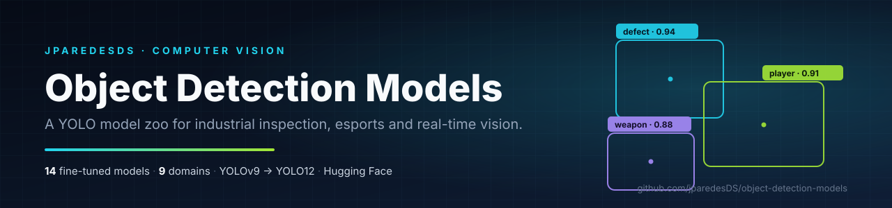

<div align="center">



# Object Detection Models

**A curated model zoo of YOLO-based object detectors for industrial inspection, esports and real-time computer vision.**

[](https://huggingface.co/jparedesDS)
[](https://github.com/ultralytics/ultralytics)
[](https://www.python.org/)
[](LICENSE)
[](https://github.com/jparedesDS/object-detection-models/stargazers)

[Model Zoo](#-model-zoo) · [Projects](#-projects) · [Quick start](#-quick-start) · [Training toolkit](#-training--annotation-toolkit) · [Documentation](docs/) · [Español](README.es.md)

</div>

---

## Why this repository

This is the single entry point for every object-detection model I train and publish. Instead of scattering weights, metrics and notebooks across a dozen repositories, everything is consolidated here:

- **14 fine-tuned detectors** across **9 real-world domains**.
- **YOLOv9, YOLOv10, YOLO11 and YOLO12** architectures, fully compatible with [Ultralytics](https://github.com/ultralytics/ultralytics).
- **Published weights and model cards** on [Hugging Face](https://huggingface.co/jparedesDS).
- **Reproducible training notebooks**, dataset tooling and inference examples.
- **Honest metrics**: precision, recall, mAP@50 and mAP@50-95 for every model where they were recorded.

The projects cover two very different worlds — industrial non-destructive testing and real-time esports computer vision — using the same training, validation and annotation pipeline.

---

## 🧠 Model Zoo

### Industrial inspection & non-destructive testing

| Model | Architecture | Task | Classes | mAP@50 | mAP@50-95 | Links |
|---|---|---|:---:|:---:|:---:|---|
| **Welding Defects Detection** | YOLO11x | Weld seam inspection | 4 | **0.842** | **0.632** | [HF](https://huggingface.co/jparedesDS/welding-defects-detection) · [Docs](projects/welding-defects-detection/) |
| **Fluorescent Penetrant Inspection** | YOLO11l | Liquid penetrant testing (FPI/PT/LPI) | 1 | **0.793** | **0.379** | [HF](https://huggingface.co/jparedesDS/fluorescent-penetrant-inspection) · [Docs](projects/fluorescent-penetrant-inspection/) |

### Esports & gaming

| Model | Architecture | Task | Classes | mAP@50 | mAP@50-95 | Links |
|---|---|---|:---:|:---:|:---:|---|
| **CS2 Players · YOLOv9c** | YOLOv9c | CS2 player & head detection | 4 | — | — | [HF](https://huggingface.co/jparedesDS/cs2-yolov9c) · [Docs](projects/cs2-players-detection/) |
| **CS2 Players · YOLOv10s** | YOLOv10s | CS2 player & head detection | 4 | **0.979** | **0.772** | [HF](https://huggingface.co/jparedesDS/cs2-yolov10s) · [Docs](projects/cs2-players-detection/) |
| **CS2 Players · YOLOv10m** | YOLOv10m | CS2 player & head detection | 4 | — | — | [HF](https://huggingface.co/jparedesDS/cs2-yolov10m) · [Docs](projects/cs2-players-detection/) |
| **CS2 Players · YOLOv10b** | YOLOv10b | CS2 player & head detection | 4 | — | — | [HF](https://huggingface.co/jparedesDS/cs2-yolov10b) · [Docs](projects/cs2-players-detection/) |
| **CS2 Players · YOLO12s** | YOLO12s | CS2 player & head detection | 4 | — | — | [HF](https://huggingface.co/jparedesDS/cs2_yolo12s) · [Docs](projects/cs2-players-detection/) |
| **CS2 Weapons · YOLO12m** | YOLO12m | CS2 weapon classification | 19 | **0.993** | **0.871** | [HF](https://huggingface.co/jparedesDS/cs2-yolo12m-weapon-detection) · [Docs](projects/cs2-weapon-detection/) |
| **Valorant Players · YOLOv10b** | YOLOv10b | Valorant body & head detection | 2 | **0.925** | **0.631** | [HF](https://huggingface.co/jparedesDS/valorant-yolov10b) · [Docs](projects/valorant-players-detection/) |
| **Valorant Players · YOLO11m** | YOLO11m | Valorant body & head detection | 2 | — | — | [HF](https://huggingface.co/jparedesDS/valorant-yolo11m) · [Docs](projects/valorant-players-detection/) |
| **Deadlock Players · YOLO11l** | YOLO11l | Deadlock combat event detection | 4 | **0.856** | **0.486** | [HF](https://huggingface.co/jparedesDS/deadlock-yolo11l) · [Docs](projects/deadlock-players-detection/) |
| **Overwatch 2 · YOLO11m** | YOLO11m | OW2 head detection | 1 | **0.660** | **0.317** | [HF](https://huggingface.co/jparedesDS/ow2-yolo11m) · [Docs](projects/overwatch2-players-detection/) |
| **Fortnite · YOLO11m** | YOLO11m | Fortnite player & head detection | 2 | **0.828** | **0.668** | [HF](https://huggingface.co/jparedesDS/fortnite-yolo11m) · [Docs](projects/fortnite-players-detection/) |
| **League of Legends · YOLO11m** | YOLO11m | Minimap champion tracking | 167 | **0.993** | **0.970** | [HF](https://huggingface.co/jparedesDS/lol-map-tracking-object-detection) · [Docs](projects/league-of-legends-tracking/) |

> **Reading the metrics.** Scores come from Ultralytics `model.val()` on each project's own validation split, using COCO-style IoU thresholds. They are **not directly comparable across projects** because the datasets, class definitions and splits differ. A dash means the metric was not published for that checkpoint; the model card is the source of truth.
>
> Some Hugging Face repositories are **gated**. Open the model card and request access before downloading the weights.

A detailed catalog with parameters, GFLOPs, weight filenames and class lists is available in **[docs/model-zoo.md](docs/model-zoo.md)**.

---

## 📂 Projects

| Project | Domain | Models | Highlights |
|---|---|:---:|---|
| [**CS2 Player Detection**](projects/cs2-players-detection/) | Counter-Strike 2 | 5 | YOLOv9c → YOLO12s · body & head classes · training notebook |
| [**CS2 Weapon Detection**](projects/cs2-weapon-detection/) | Counter-Strike 2 | 1 | 19 weapon classes · mAP@50 **0.993** |
| [**Valorant Player Detection**](projects/valorant-players-detection/) | Valorant | 2 | Body & head classes · YOLOv10b / YOLO11m |
| [**Deadlock Player Detection**](projects/deadlock-players-detection/) | Deadlock | 1 | Enemy, minion, hit and deny events |
| [**Fortnite Player Detection**](projects/fortnite-players-detection/) | Fortnite | 1 | Player & head detection · most-liked model |
| [**Overwatch 2 Detection**](projects/overwatch2-players-detection/) | Overwatch 2 | 1 | Head-only detector |
| [**League of Legends Tracking**](projects/league-of-legends-tracking/) | League of Legends | 1 | 167 champion classes · minimap tracking |
| [**Welding Defects Detection**](projects/welding-defects-detection/) | Industrial NDT | 1 | Defect, welding line, workpiece & porosity · training notebook |
| [**Fluorescent Penetrant Inspection**](projects/fluorescent-penetrant-inspection/) | Industrial NDT | 1 | Liquid penetrant defect detection (FPI / PT / LPI) |

---

## 🚀 Quick start

### 1. Install the dependencies

```bash
git clone https://github.com/jparedesDS/object-detection-models.git
cd object-detection-models
pip install -r requirements.txt
```

### 2. Download a model from Hugging Face

```bash
# Example: CS2 player detector (YOLOv10s)
hf download jparedesDS/cs2-yolov10s cs2_yolov10s.pt --local-dir weights
```

> `hf` ships with `huggingface_hub` ≥ 0.24. On older installations use `huggingface-cli download`.
> If the repository is gated, accept the conditions on its model card first and run `hf auth login`.

### 3. Run inference

```python
from ultralytics import YOLO

model = YOLO("weights/cs2_yolov10s.pt")

results = model.predict(
    source="image.jpg",
    conf=0.25,
    save=True,
    device=0,          # "cpu" if you do not have a GPU
)
```

### 4. Video, webcam or screen capture

```python
# Video file or webcam (source=0)
model.predict(source="clip.mp4", stream=True, save=True)
```

For real-time screen capture, see [`examples/screen_inference.py`](examples/screen_inference.py):

```bash
python examples/screen_inference.py --model weights/ow2-yolo11m.pt
```

Each project README includes the exact weight filename and class list for its models.

---

## 🗂 Repository structure

```text
object-detection-models/
├── assets/                  # Banner and shared media
├── docs/                    # Model catalog, training and annotation guides
├── examples/                # Inference examples (screen capture, video)
├── notebooks/               # End-to-end YOLO training guide
├── tools/
│   ├── annotations/         # Pseudo-labeling, auditing, remapping and dataset splits
│   └── augmentation/        # Offline augmentation with OpenCV
└── projects/
    ├── cs2-players-detection/
    ├── cs2-weapon-detection/
    ├── valorant-players-detection/
    ├── deadlock-players-detection/
    ├── fortnite-players-detection/
    ├── overwatch2-players-detection/
    ├── league-of-legends-tracking/
    ├── welding-defects-detection/
    └── fluorescent-penetrant-inspection/
        ├── README.md        # Model card, labels, metrics and usage
        ├── assets/          # Curves, confusion matrices and predictions
        └── notebooks/       # Optional training notebook
```

---

## 🛠 Training & annotation toolkit

The `tools/` directory contains the utilities used to build these datasets. They are pragmatic scripts: open them, set the paths at the top and run them.

| Tool | What it does |
|---|---|
| [`auto_label.py`](tools/annotations/auto_label.py) | Generates YOLO pseudo-labels for unlabeled images with a trained model; quarantines images with no detections. |
| [`check_labels.py`](tools/annotations/check_labels.py) | Audits a dataset: instances per class and number of background images. |
| [`remap_labels.py`](tools/annotations/remap_labels.py) | Remaps or merges class IDs across every `.txt` label file in a directory. |
| [`split_train_val.py`](tools/annotations/split_train_val.py) | Splits a flat image/label dataset into train and validation sets. |
| [`move_split_files.py`](tools/annotations/move_split_files.py) | Distributes augmented images and labels into train/validation folders. |
| [`move_labels.py`](tools/annotations/move_labels.py) | Collects label files into the canonical `labels/` directory. |
| [`augment_dataset.py`](tools/augmentation/augment_dataset.py) | Offline augmentation: contrast scaling and horizontal flipping with label correction. |
| [`screen_inference.py`](examples/screen_inference.py) | Real-time inference over a screen region with OpenCV. |

Guides:

- **[Training guide](docs/training-guide.md)** — dataset layout, `data.yaml`, training, validation and export.
- **[Annotation tools](docs/annotation-tools.md)** — what each script expects and the recommended workflow.
- **[YOLO training notebook](notebooks/yolo-training-guide.ipynb)** — the full Spanish-language walkthrough used to train these models.

---

## 🏷 Class labels

| Project | Labels |
|---|---|
| CS2 players | `CT`, `CT_head`, `T`, `T_head` |
| CS2 weapons | `AK47`, `M4A1-S`, `M4A1`, `GALIL`, `FAMAS`, `TEC-9`, `FIVE-SEVEN`, `GLOCK-18`, `USP-S`, `EAGLE`, `BERETTAS`, `P2000`, `MAC10`, `MP5`, `MP9`, `P90`, `P250`, `SSG08`, `AWP` |
| Valorant | `Body`, `Head` |
| Deadlock | `deny`, `enemy`, `hit`, `minions` |
| Fortnite | `head`, `player` |
| Overwatch 2 | `Head` |
| League of Legends | 167 champion names — [full list](docs/model-zoo.md#league-of-legends-167-classes) |
| Welding defects | `Defect`, `Welding Line`, `Workpiece`, `porosity` |
| Fluorescent penetrant inspection | `defecto` |

---

## 📊 Evaluation protocol

- Framework: [Ultralytics](https://github.com/ultralytics/ultralytics) `model.val()`.
- Metrics: precision (P), recall (R), mAP@50 and mAP@50-95 (COCO IoU sweep from 0.50 to 0.95).
- Splits: each project uses its own held-out validation split; the split size is documented in the project README.
- Reproducibility: training notebooks and augmentation scripts are included where available. Exact dataset snapshots are not distributed.

If you need a metric that is missing from a table, open the corresponding model card on Hugging Face — the training artifacts (`results.csv`, curves, confusion matrix) are uploaded there.

---

## 🗺 Roadmap

- [ ] Add ONNX and TensorRT exports for low-latency inference.
- [ ] Publish dataset cards and annotation statistics per project.
- [ ] Add Colab notebooks for zero-setup inference.
- [ ] Benchmark all detectors on a shared, documented protocol.
- [ ] Keep adding new architectures as Ultralytics releases them.

---

## 🤝 Contributing

Contributions, bug reports and model requests are welcome. Please read [CONTRIBUTING.md](CONTRIBUTING.md) before opening an issue or a pull request.

If you use these models in research or production, a citation and a ⭐ on the repository are appreciated.

---

## 📝 Citation

```bibtex
@misc{paredes2026objectdetection,
  author       = {Paredes, José},
  title        = {Object Detection Models: A YOLO Model Zoo for Industrial Inspection and Esports},
  year         = {2026},
  publisher    = {GitHub},
  howpublished = {\url{https://github.com/jparedesDS/object-detection-models}},
  note         = {Model weights: \url{https://huggingface.co/jparedesDS}}
}
```

---

## 📄 License

Released under the [MIT License](LICENSE). The models are provided as-is for research and educational use. You are responsible for complying with the terms of service of any game or platform whose imagery is used with these detectors.

---

## ☕ Support

If these models saved you time, you can support their maintenance:

<a href="https://buymeacoffee.com/joseparedes" target="_blank">
  
</a>

<div align="center">
  <sub>Built and maintained by <a href="https://github.com/jparedesDS">José Paredes</a> · <a href="https://huggingface.co/jparedesDS">Hugging Face</a></sub>
</div>
