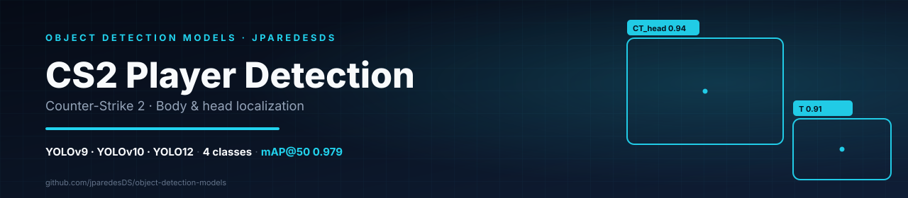
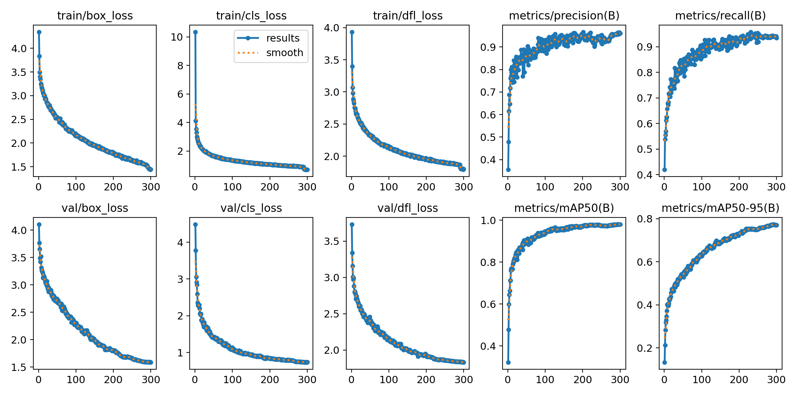
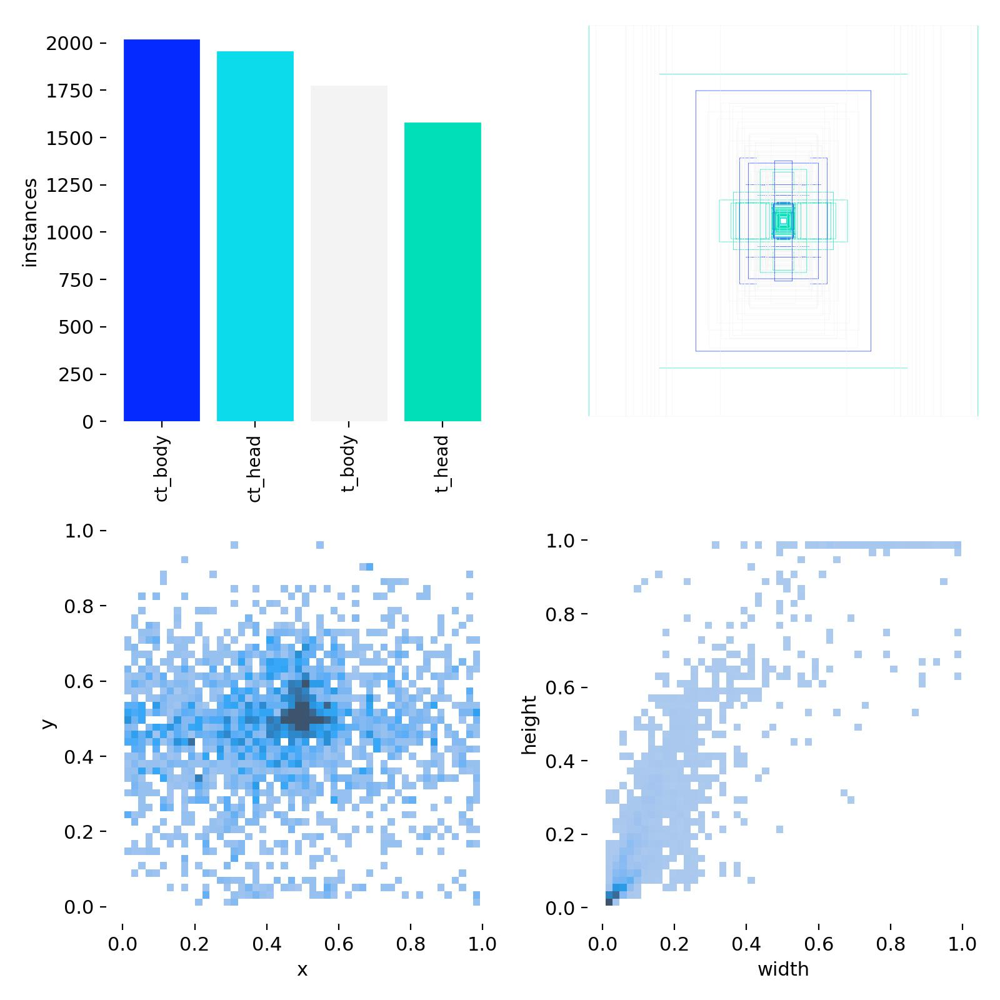
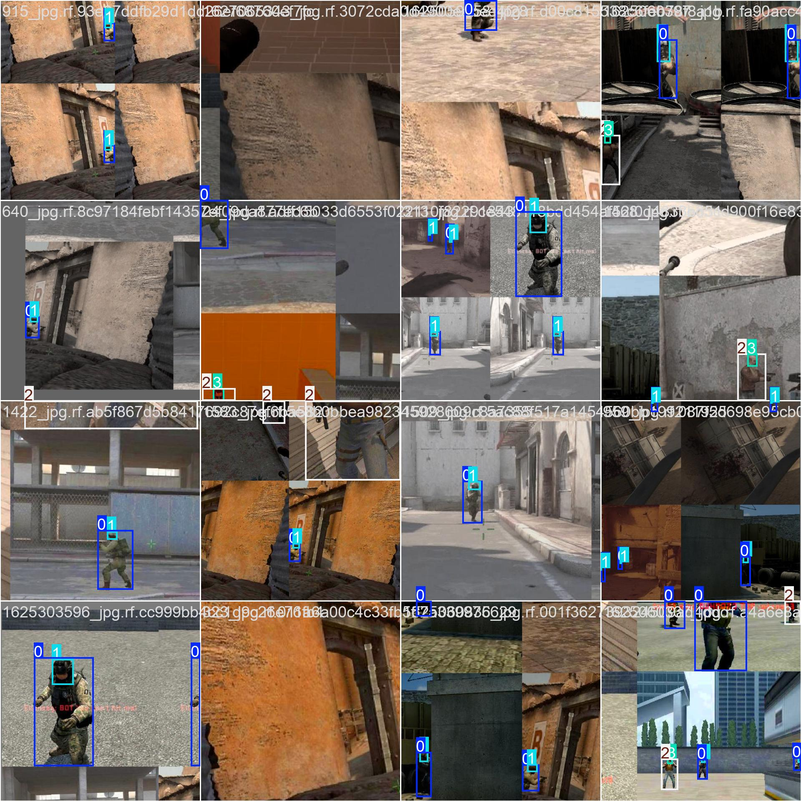

<div align="center">



# CS2 Player Detection

**YOLOv9, YOLOv10 and YOLO12 detectors for Counter-Strike 2 player and head localization.**

[](https://github.com/ultralytics/ultralytics)
[](#results)
[](#class-labels)
[](https://huggingface.co/jparedesDS)

[← Model zoo](../../README.md) · [Full catalog](../../docs/model-zoo.md) · [Training guide](../../docs/training-guide.md)

</div>

---

## At a glance

| Property | Value |
|---|---|
| **Task** | Player body and head localization in Counter-Strike 2 |
| **Architectures** | YOLOv9c, YOLOv10s/m/b, YOLO12s |
| **Checkpoints** | 5 |
| **Classes** | `CT`, `CT_head`, `T`, `T_head` |
| **Best mAP@50** | **0.979** (YOLOv10s) |
| **Best mAP@50-95** | **0.772** (YOLOv10s) |
| **Weights** | [`cs2_yolov10s.pt`](https://huggingface.co/jparedesDS/cs2-yolov10s) and 4 more on Hugging Face |
| **Training notebook** | [`notebooks/yolov10s_training.ipynb`](notebooks/yolov10s_training.ipynb) |

## Overview

Five checkpoints trained to detect player bodies and heads in Counter-Strike 2 footage. The models are intended for computer-vision research, broadcast analysis and game-state extraction — not for interfering with live matches.

The dataset uses four classes that separate team identity from body part, so downstream code can reason about *who* is visible and *where* the head is without retraining. Across the series, the same dataset was used to compare how YOLOv9, YOLOv10 and YOLO12 behave on a small-object, high-occlusion problem.

## Models

| Model | Architecture | Weights | Params | mAP@50 | mAP@50-95 | Hugging Face |
|---|---|---|:---:|:---:|:---:|---|
| CS2 · YOLOv9c | YOLOv9c | `yolov9c_cs2.pt` | — | — | — | [`cs2-yolov9c`](https://huggingface.co/jparedesDS/cs2-yolov9c) |
| CS2 · YOLOv10s | YOLOv10s | `cs2_yolov10s.pt` | 8.0 M | **0.979** | **0.772** | [`cs2-yolov10s`](https://huggingface.co/jparedesDS/cs2-yolov10s) |
| CS2 · YOLOv10m | YOLOv10m | `yolov10m_cs2.pt` | — | — | — | [`cs2-yolov10m`](https://huggingface.co/jparedesDS/cs2-yolov10m) |
| CS2 · YOLOv10b | YOLOv10b | `yolov10b_cs2.pt` | — | — | — | [`cs2-yolov10b`](https://huggingface.co/jparedesDS/cs2-yolov10b) |
| CS2 · YOLO12s | YOLO12s | `cs2_yolo12s.pt` | — | — | — | [`cs2_yolo12s`](https://huggingface.co/jparedesDS/cs2_yolo12s) |

> All five repositories are gated on Hugging Face: accept the conditions on the model card and run `hf auth login` before downloading.
>
> A dash means the metric was not recorded in the training artifacts available for that checkpoint.

## Class labels

| ID | Label | Meaning |
|:---:|---|---|
| 0 | `CT` | Counter-Terrorist body |
| 1 | `CT_head` | Counter-Terrorist head |
| 2 | `T` | Terrorist body |
| 3 | `T_head` | Terrorist head |

The head/body split is deliberate: heads are small and heavily occluded, so mixing them with bodies would hide the hardest failure mode behind a strong body score.

## Results

Metrics for the YOLOv10s checkpoint on its validation split (160 images, 372 instances):

| Class | Precision | Recall | mAP@50 | mAP@50-95 |
|---|---:|---:|---:|---:|
| **all** | **0.958** | **0.940** | **0.979** | **0.772** |
| `ct_body` | 0.964 | 0.964 | 0.988 | 0.861 |
| `ct_head` | 0.946 | 0.847 | 0.953 | 0.634 |
| `t_body` | 0.986 | 0.976 | 0.990 | 0.866 |
| `t_head` | 0.938 | 0.973 | 0.984 | 0.728 |

Head localization is the hardest class, which is expected: heads are small, partially occluded and often overlap with the body box.

### Training results and label distribution

<p align="center">
  
  
</p>

### Batch preview

<p align="center">
  
</p>

## Quick start

```bash
hf download jparedesDS/cs2-yolov10s cs2_yolov10s.pt --local-dir weights
```

```python
from ultralytics import YOLO

model = YOLO("weights/cs2_yolov10s.pt")
results = model.predict("frame.jpg", conf=0.25, save=True, device=0)

for box in results[0].boxes:
    print(model.names[int(box.cls)], float(box.conf))
```

The same API works with every checkpoint: change the weight file and keep the class IDs.

## Dataset

- **Source:** Counter-Strike 2 gameplay frames captured at 16:9.
- **Format:** YOLO boxes, one `.txt` per image.
- **Classes:** 4, separating team (`CT`/`T`) from body part (`body`/`head`).
- **Variation:** multiple maps, lighting conditions and weapon viewpoints.
- **Distribution:** the dataset is **not** distributed. Class definitions and validation metrics are documented so equivalent datasets can be rebuilt.
- **Quality control:** annotations were audited with [`check_labels.py`](../../tools/annotations/check_labels.py); low-confidence images were pseudo-labeled with [`auto_label.py`](../../tools/annotations/auto_label.py) and corrected manually.

## Training

[`notebooks/yolov10s_training.ipynb`](notebooks/yolov10s_training.ipynb) contains the YOLOv10s training workflow, including dataset preparation and evaluation.

General instructions: [docs/training-guide.md](../../docs/training-guide.md).

## Related projects

- [CS2 Weapon Detection](../cs2-weapon-detection/) — 19-class weapon detector built on the same capture pipeline.
- [Valorant Player Detection](../valorant-players-detection/) — the same body/head formulation in a different tactical shooter.
- [Full model zoo](../../docs/model-zoo.md) — every checkpoint, parameter count and class list.

## License

MIT. See the [repository license](../../LICENSE).
