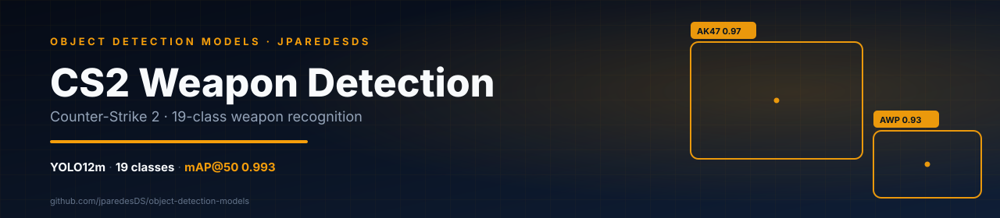
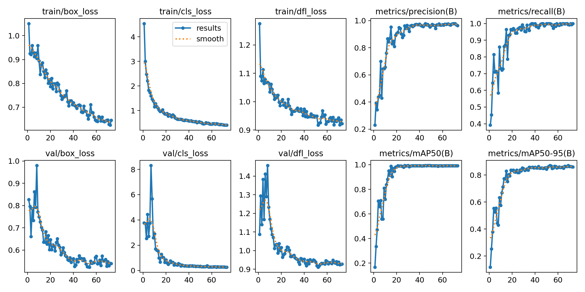
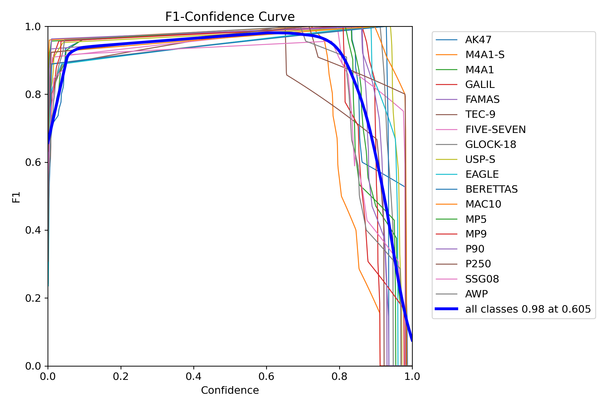
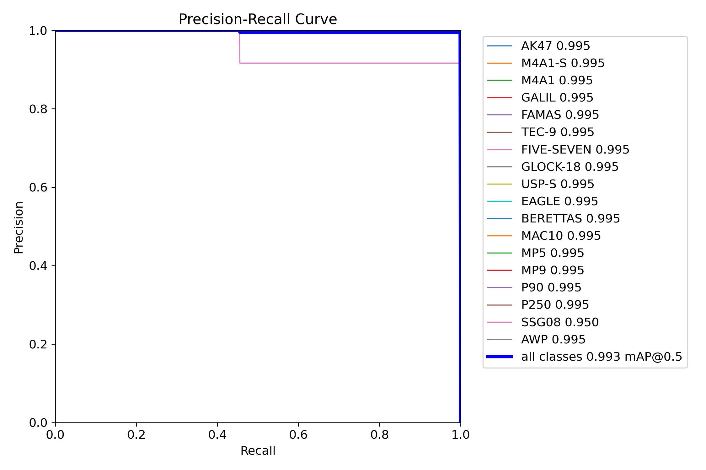
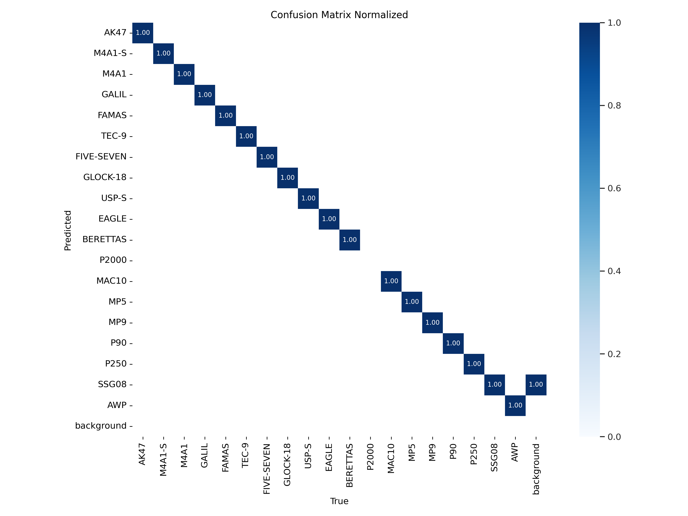
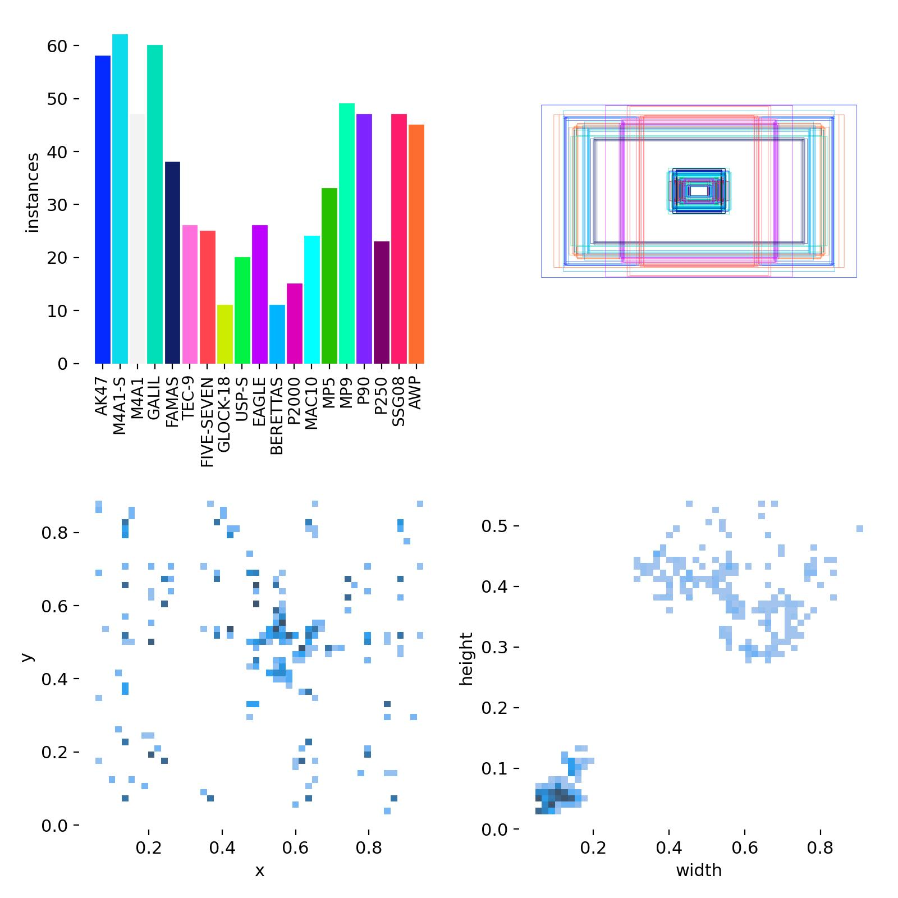
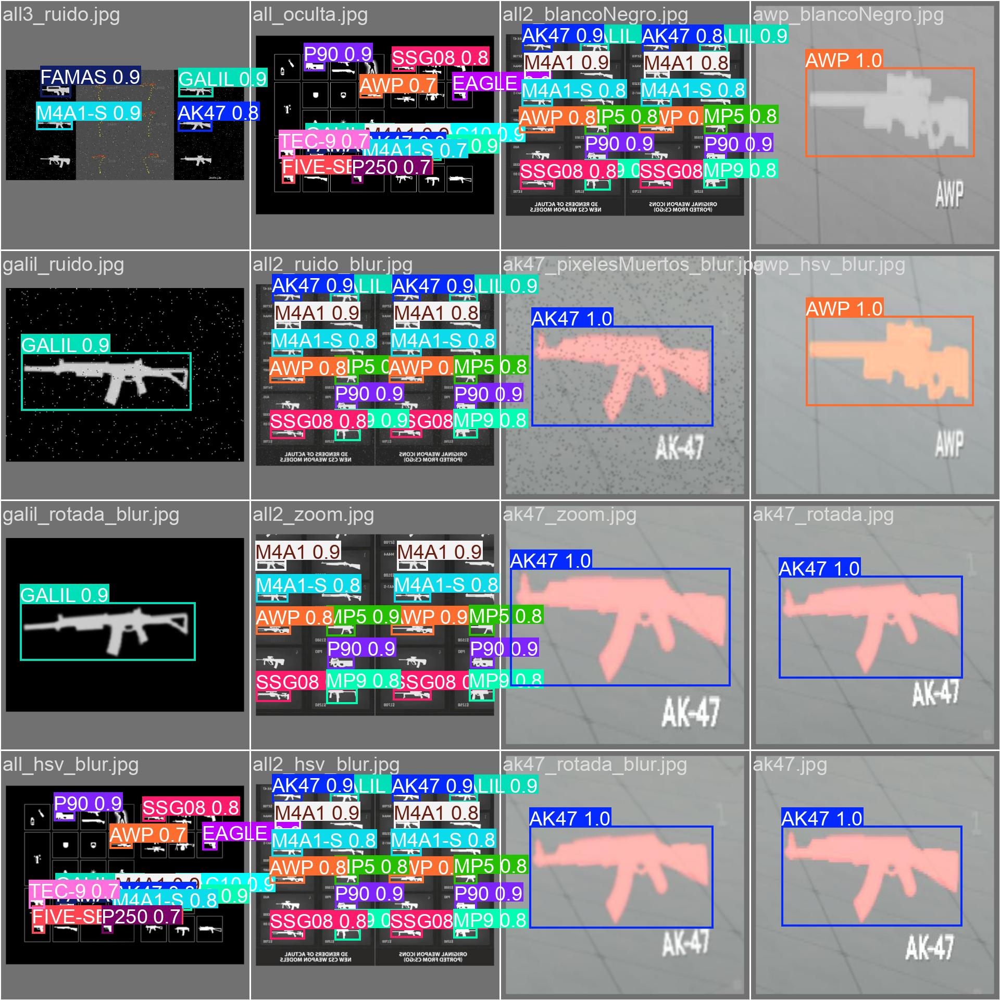

<div align="center">



# CS2 Weapon Detection

**A 19-class YOLO12m detector for recognizing weapons in Counter-Strike 2 footage.**

[](https://github.com/ultralytics/ultralytics)
[](#results)
[](#class-labels)
[](https://huggingface.co/jparedesDS/cs2-yolo12m-weapon-detection)

[← Model zoo](../../README.md) · [Full catalog](../../docs/model-zoo.md) · [Training guide](../../docs/training-guide.md)

</div>

---

## At a glance

| Property | Value |
|---|---|
| **Task** | Weapon recognition in Counter-Strike 2 |
| **Architecture** | YOLO12m |
| **Classes** | 19 |
| **Weights** | `cs2-yolo12m-weapon-detection.pt` |
| **Parameters** | 20.1 M |
| **GFLOPs** | 67.2 |
| **mAP@50** | **0.993** |
| **mAP@50-95** | **0.871** |
| **Validation split** | 87 images / 158 instances |
| **Model card** | [`jparedesDS/cs2-yolo12m-weapon-detection`](https://huggingface.co/jparedesDS/cs2-yolo12m-weapon-detection) |

This repository is **publicly downloadable** — no gating.

## Overview

Weapon recognition is useful for broadcast overlays, match analytics and dataset indexing: once frames are tagged by weapon, you can filter highlights, study economy decisions or build weapon-specific detectors.

This is a single-stage detector with **19 weapon classes**, trained on labeled CS2 frames. It recognizes the weapon held or visible in the frame; it does not identify the player or the team. The checkpoint is also the reference example of a YOLO12 model in this zoo.

## Highlights

- **19 classes** covering rifles, SMGs, pistols, sniper rifles and the AWP.
- **0.993 mAP@50** and **0.871 mAP@50-95** on the recorded validation split.
- **No gating**: clone the weights directly from Hugging Face.
- Trained with the same annotation and augmentation pipeline as the rest of the zoo.

## Class labels

```text
AK47, M4A1-S, M4A1, GALIL, FAMAS, TEC-9, FIVE-SEVEN, GLOCK-18, USP-S,
EAGLE, BERETTAS, P2000, MAC10, MP5, MP9, P90, P250, SSG08, AWP
```

| ID | Weapon | ID | Weapon |
|:---:|---|:---:|---|
| 0 | AK47 | 10 | EAGLE |
| 1 | M4A1-S | 11 | BERETTAS |
| 2 | M4A1 | 12 | MAC10 |
| 3 | GALIL | 13 | MP5 |
| 4 | FAMAS | 14 | MP9 |
| 5 | TEC-9 | 15 | P90 |
| 6 | FIVE-SEVEN | 16 | P250 |
| 7 | GLOCK-18 | 17 | SSG08 |
| 8 | USP-S | 18 | AWP |
| 9 | P2000 | | |

## Results

| Class | Precision | Recall | mAP@50 | mAP@50-95 |
|---|---:|---:|---:|---:|
| **all** | **0.963** | **1.000** | **0.993** | **0.871** |

<details>
<summary><strong>Per-class metrics</strong></summary>

| Class | Precision | Recall | mAP@50 | mAP@50-95 |
|---|---:|---:|---:|---:|
| AK47 | 0.979 | 1.000 | 0.995 | 0.853 |
| M4A1-S | 0.987 | 1.000 | 0.995 | 0.849 |
| M4A1 | 0.978 | 1.000 | 0.995 | 0.844 |
| GALIL | 0.974 | 1.000 | 0.995 | 0.859 |
| FAMAS | 0.963 | 1.000 | 0.995 | 0.926 |
| TEC-9 | 0.985 | 1.000 | 0.995 | 0.917 |
| FIVE-SEVEN | 0.960 | 1.000 | 0.995 | 0.903 |
| GLOCK-18 | 0.932 | 1.000 | 0.995 | 0.905 |
| USP-S | 0.966 | 1.000 | 0.995 | 0.900 |
| EAGLE | 0.933 | 1.000 | 0.995 | 0.847 |
| BERETTAS | 0.929 | 1.000 | 0.995 | 0.948 |
| MAC10 | 0.953 | 1.000 | 0.995 | 0.891 |
| MP5 | 0.978 | 1.000 | 0.995 | 0.852 |
| MP9 | 0.978 | 1.000 | 0.995 | 0.888 |
| P90 | 0.978 | 1.000 | 0.995 | 0.842 |
| P250 | 0.977 | 1.000 | 0.995 | 0.861 |
| SSG08 | 0.900 | 1.000 | 0.950 | 0.785 |
| AWP | 0.990 | 1.000 | 0.995 | 0.805 |

</details>

> The validation split is small (158 instances across 19 classes), so per-class variance is high. Treat these numbers as an upper-bound estimate and re-evaluate on a larger, independent set before production use.

### Training results and curves

<p align="center">
  
  
</p>

<p align="center">
  
  
</p>

### Label distribution

<p align="center">
  
</p>

### Predictions

<p align="center">
  
</p>

## Quick start

```bash
hf download jparedesDS/cs2-yolo12m-weapon-detection \
  cs2-yolo12m-weapon-detection.pt --local-dir weights
```

```python
from ultralytics import YOLO

model = YOLO("weights/cs2-yolo12m-weapon-detection.pt")
results = model.predict("frame.jpg", conf=0.4, save=True, device=0)

for box in results[0].boxes:
    print(model.names[int(box.cls)], float(box.conf))
```

## Dataset

- **Source:** Counter-Strike 2 gameplay frames, first-person and spectator views.
- **Format:** YOLO boxes, 19 classes.
- **Challenges:** small objects, motion blur, weapon skins and partial occlusion.
- **Distribution:** dataset images are **not** distributed. The class list and metrics are documented so the dataset can be rebuilt.
- **Caveat:** the clean, repeated-scene validation split explains part of the very high score. An independent test set is the right next step.

## Related projects

- [CS2 Player Detection](../cs2-players-detection/) — body and head detection on the same game.
- [Full model zoo](../../docs/model-zoo.md) — all checkpoints and class taxonomies.

## License

MIT. See the [repository license](../../LICENSE).
