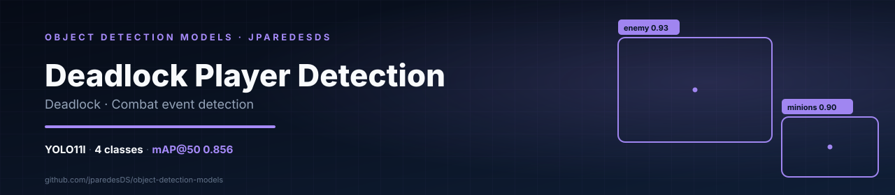
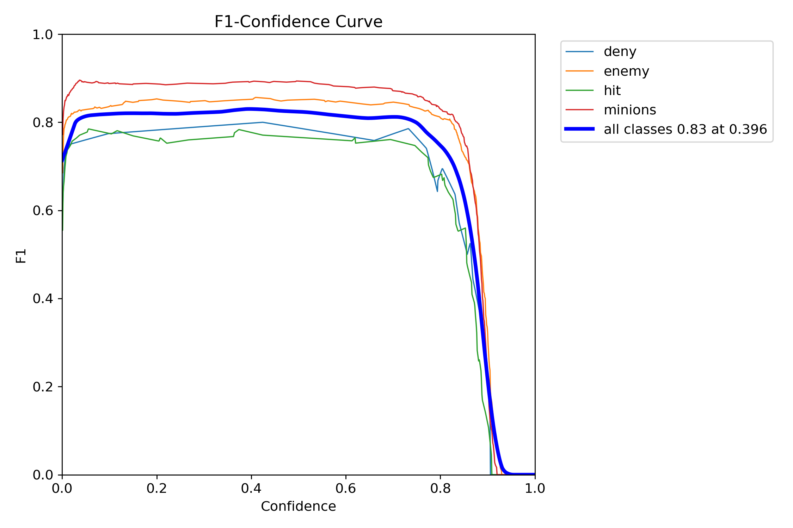
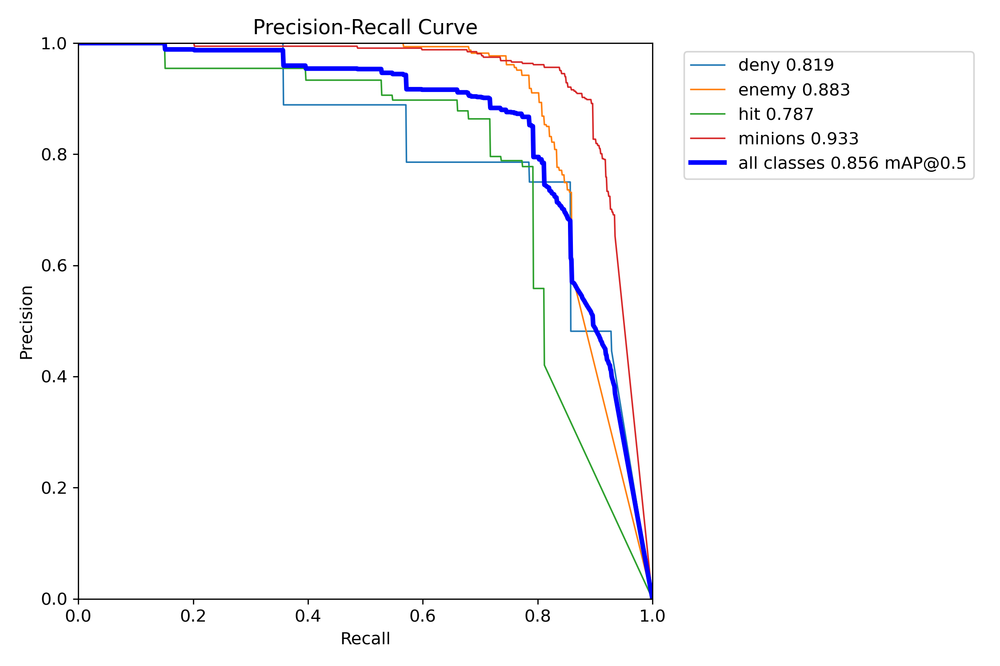

<div align="center">



# Deadlock Player Detection

**A YOLO11l detector for combat events in Deadlock: enemies, minions, hits and denies.**

[](https://github.com/ultralytics/ultralytics)
[](#results)
[](#class-labels)
[](https://huggingface.co/jparedesDS/deadlock-yolo11l)

[← Model zoo](../../README.md) · [Full catalog](../../docs/model-zoo.md) · [Training guide](../../docs/training-guide.md)

</div>

---

## At a glance

| Property | Value |
|---|---|
| **Task** | Combat event detection in Deadlock |
| **Architecture** | YOLO11l |
| **Checkpoint** | `yolo11l_deadlock.pt` |
| **Classes** | `deny`, `enemy`, `hit`, `minions` |
| **Parameters** | 25.3 M |
| **GFLOPs** | 86.6 |
| **mAP@50** | **0.856** |
| **mAP@50-95** | **0.486** |
| **Validation split** | 551 images / 661 instances |
| **Model card** | [`jparedesDS/deadlock-yolo11l`](https://huggingface.co/jparedesDS/deadlock-yolo11l) |

The Hugging Face repository is gated: accept the conditions on the model card and authenticate with `hf auth login` before downloading.

## Overview

Deadlock mixes third-person shooting with MOBA mechanics, so a useful detector has to recognize more than players: lane minions, hit markers and deny indicators all carry information about the game state.

This YOLO11l checkpoint was trained on labeled Deadlock frames with four event classes. It is a good example of adapting a general-purpose detector to a game-specific vocabulary instead of forcing everything into a single `player` class.

The model is intended for computer-vision research, broadcast analysis and game-state extraction. It is not designed for, and should not be used for, interfering with live matches.

## Highlights

- **Four event classes** instead of a generic player box: `enemy`, `minions`, `hit` and `deny`.
- **0.856 mAP@50** and **0.486 mAP@50-95** on the recorded validation split.
- **YOLO11l** offers a good accuracy/cost balance for 16:9 gameplay frames at inference time.
- Transient UI events (`hit`, `deny`) make this a useful benchmark for temporal, event-oriented detection.
- Built with the same annotation, augmentation and evaluation pipeline as the rest of the zoo.

## Class labels

| ID | Label | Meaning |
|:---:|---|---|
| 0 | `deny` | Deny indicator |
| 1 | `enemy` | Enemy player |
| 2 | `hit` | Hit confirmation |
| 3 | `minions` | Lane minions |

`hit` and `deny` are transient UI events: a single frame may not contain the indicator even when the event happened. That temporal ambiguity is the main reason their scores trail the player and minion classes.

## Results

| Class | Precision | Recall | mAP@50 | mAP@50-95 |
|---|---:|---:|---:|---:|
| **all** | **0.874** | **0.798** | **0.856** | **0.486** |
| `deny` | 0.748 | 0.857 | 0.819 | 0.480 |
| `enemy` | 0.942 | 0.785 | 0.883 | 0.508 |
| `hit` | 0.861 | 0.704 | 0.787 | 0.409 |
| `minions` | 0.945 | 0.847 | 0.933 | 0.546 |

`minions` and `enemy` benefit from stable, repeated visual patterns. `hit` has the lowest recall because the marker flashes for a short window and is often partially transparent. `deny` is rare in the dataset, so its estimate is noisier than its score suggests.

### Training results and curves

<p align="center">
  
  
</p>

<p align="center">
  
  
</p>

### Label distribution

<p align="center">
  
</p>

### Predictions

<p align="center">
  
</p>

## Quick start

```bash
hf download jparedesDS/deadlock-yolo11l yolo11l_deadlock.pt --local-dir weights
```

```python
from ultralytics import YOLO

model = YOLO("weights/yolo11l_deadlock.pt")
results = model.predict("frame.jpg", conf=0.3, save=True, device=0)

for box in results[0].boxes:
    print(model.names[int(box.cls)], float(box.conf))
```

### Reading event classes

For event detection, run the model over consecutive frames and post-process the detections:

- Aggregate `hit` and `deny` detections across a short window instead of trusting a single frame.
- Track `enemy` boxes with ByteTrack or BoT-SORT if you need identities.
- Keep `minions` separate from players; their scale and motion statistics are different.

## Dataset

- **Source:** Deadlock gameplay frames captured at 16:9.
- **Format:** YOLO boxes, one `.txt` per image, four classes.
- **Class imbalance:** `enemy` and `minions` dominate; `deny` and `hit` are comparatively rare.
- **Variation:** multiple heroes, lanes, lighting conditions and camera distances.
- **Distribution:** dataset images are **not** distributed. Class definitions and metrics are documented so an equivalent dataset can be rebuilt.
- **Quality control:** annotations were checked with [`check_labels.py`](../../tools/annotations/check_labels.py); low-confidence frames were pre-labeled with [`auto_label.py`](../../tools/annotations/auto_label.py) and corrected manually.

## Related projects

- [CS2 Player Detection](../cs2-players-detection/) — body and head detection in a tactical shooter.
- [Valorant Player Detection](../valorant-players-detection/) — the same body/head formulation in another competitive game.
- [Full model zoo](../../docs/model-zoo.md) — every checkpoint, parameter count and class list.

## License

MIT. See the [repository license](../../LICENSE).
