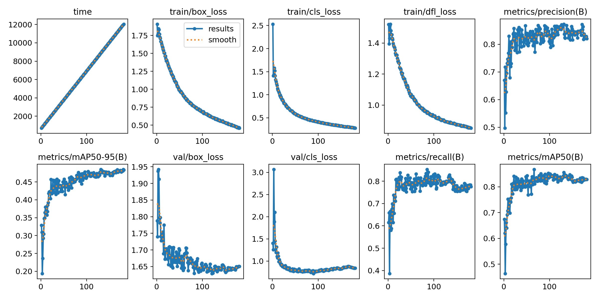
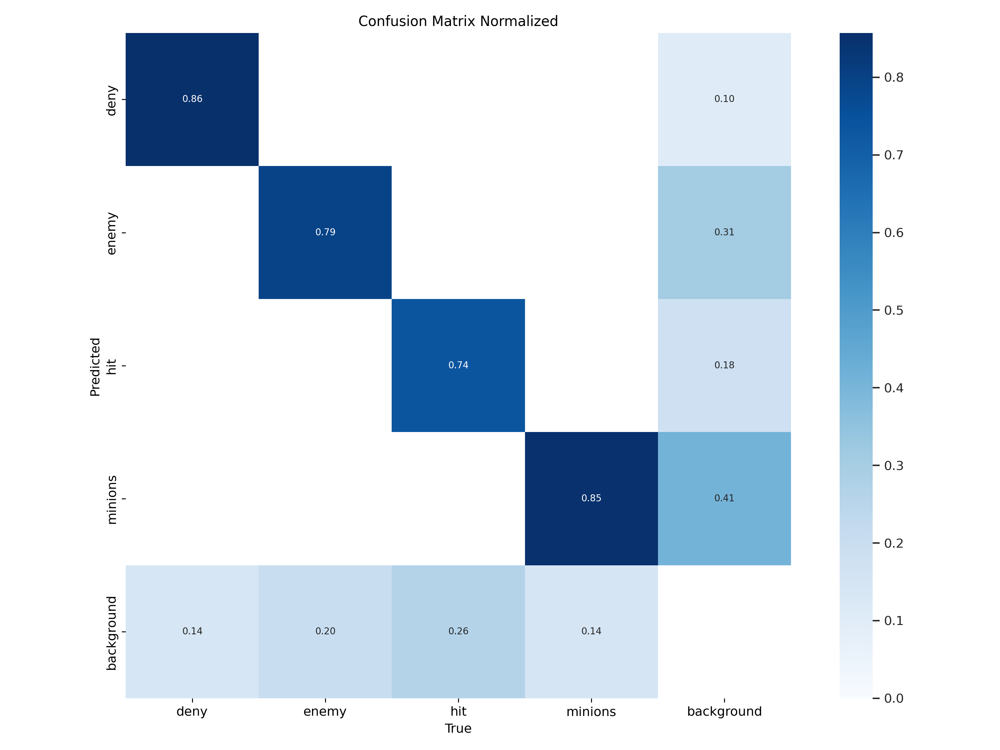
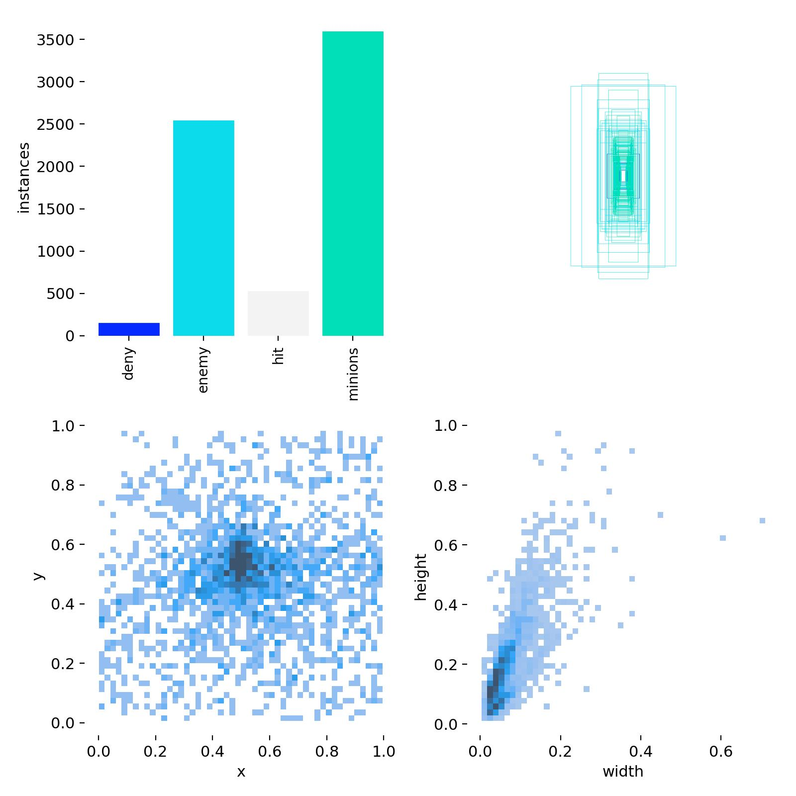
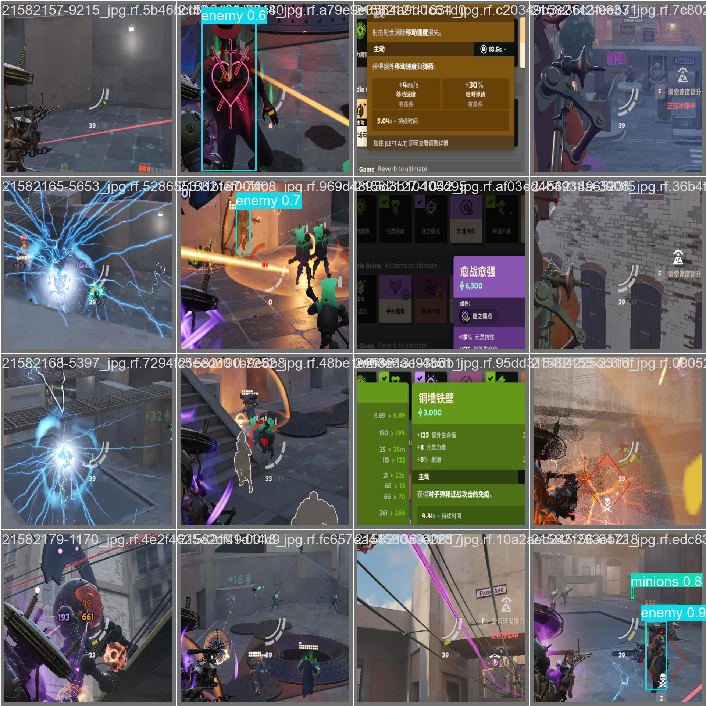

<div align="center">

# Deadlock Player Detection

**A YOLO11l detector for combat events in Deadlock: enemies, minions, hits and denies.**

[](https://github.com/ultralytics/ultralytics)
[](#results)
[](https://huggingface.co/jparedesDS/deadlock-yolo11l)

[← Back to the model zoo](../../README.md) · [Full catalog](../../docs/model-zoo.md)

</div>

---

## Overview

Deadlock mixes third-person shooting with MOBA mechanics, so a useful detector has to recognize more than players: minions, hit markers and deny indicators matter for reading the game state.

This YOLO11l checkpoint was trained on labeled Deadlock frames with four event classes. It is a good example of adapting a general-purpose detector to a game-specific vocabulary instead of forcing everything into a `player` class.

## Model

| Property | Value |
|---|---|
| Architecture | YOLO11l |
| Weights | `yolo11l_deadlock.pt` |
| Parameters | 25.3 M |
| GFLOPs | 86.6 |
| Classes | 4 |
| mAP@50 | **0.856** |
| mAP@50-95 | **0.486** |
| Validation split | 551 images / 661 instances |
| Hugging Face | [`jparedesDS/deadlock-yolo11l`](https://huggingface.co/jparedesDS/deadlock-yolo11l) |

The Hugging Face repository is gated (`auto`): access is granted after accepting the conditions on the model card.

## Class labels

| ID | Label | Meaning |
|:---:|---|---|
| 0 | `deny` | Deny indicator |
| 1 | `enemy` | Enemy player |
| 2 | `hit` | Hit confirmation |
| 3 | `minions` | Lane minions |

## Results

| Class | Precision | Recall | mAP@50 | mAP@50-95 |
|---|---:|---:|---:|---:|
| **all** | **0.874** | **0.798** | **0.856** | **0.486** |
| `deny` | 0.748 | 0.857 | 0.819 | 0.480 |
| `enemy` | 0.942 | 0.785 | 0.883 | 0.508 |
| `hit` | 0.861 | 0.704 | 0.787 | 0.409 |
| `minions` | 0.945 | 0.847 | 0.933 | 0.546 |

`hit` and `deny` are transient UI events, so their low recall is expected: a single frame may not contain the indicator even when the event happened.

### Training curves



### Confusion matrix



### Label distribution



### Predictions



## Quick start

```bash
hf download jparedesDS/deadlock-yolo11l yolo11l_deadlock.pt --local-dir weights
```

```python
from ultralytics import YOLO

model = YOLO("weights/yolo11l_deadlock.pt")
results = model.predict("frame.jpg", conf=0.3, save=True, device=0)
```

## Dataset notes

- Source: Deadlock gameplay frames.
- Four event classes, YOLO-format boxes.
- Class imbalance is significant: `enemy` and `minions` dominate the dataset, while `deny` and `hit` are rare.
- Dataset images are not distributed.

## License

MIT. See the [repository license](../../LICENSE).
