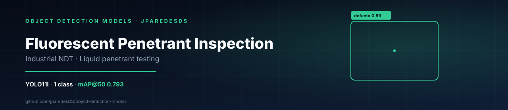
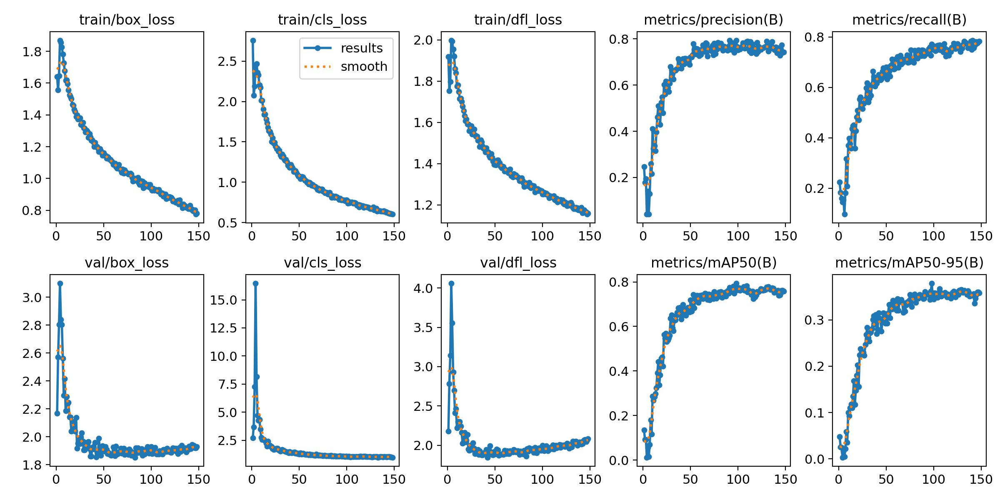

<div align="center">



# Fluorescent Penetrant Inspection

**A YOLO11l detector for liquid penetrant testing (FPI / PT / LPI).**

[](https://github.com/ultralytics/ultralytics)
[](#results)
[](#class-labels)
[](https://huggingface.co/jparedesDS/fluorescent-penetrant-inspection)

[← Model zoo](../../README.md) · [Full catalog](../../docs/model-zoo.md) · [Training guide](../../docs/training-guide.md)

</div>

---

## At a glance

| Property | Value |
|---|---|
| **Task** | Defect indication detection in fluorescent penetrant inspection |
| **Architecture** | YOLO11l |
| **Checkpoint** | `yolo11l_LPI.pt` |
| **Classes** | `defecto` |
| **Parameters** | 25.3 M |
| **GFLOPs** | 86.6 |
| **mAP@50** | **0.793** |
| **mAP@50-95** | **0.379** |
| **Validation split** | 836 images / 752 instances |
| **Model card** | [`jparedesDS/fluorescent-penetrant-inspection`](https://huggingface.co/jparedesDS/fluorescent-penetrant-inspection) |

The Hugging Face repository is gated: accept the conditions on the model card and authenticate with `hf auth login` before downloading.

> **Not a certified inspection system.** This is a research prototype. Qualification of penetrant inspection procedures, personnel and acceptance criteria remains with the responsible NDT organization.

## Overview

Liquid penetrant inspection is a non-destructive testing method for finding surface-breaking defects in non-porous materials. A penetrant is applied to the part, excess is removed, a developer draws the penetrant out of discontinuities, and the inspector looks for indications — often under UV light in the fluorescent variant (FPI).

The visual signal is unusual: bright fluorescent indications on a dark surface, with strong glare, reflections and uneven illumination. This project trains a single-class YOLO11l detector to localize those indications, as a first step toward assisted visual inspection.

The single class (`defecto`) reflects the inspection question: *is there an indication here, and where?* It does not attempt to classify the defect type or measure its depth.

## Highlights

- **Single-class formulation** that matches the first task in penetrant inspection: find indications.
- **0.793 mAP@50** on a validation split of 836 images.
- **YOLO11l** provides a strong backbone without the cost of an extra-large model.
- Explicit analysis of the mAP@50 vs mAP@50-95 gap, which is the key limitation for defect sizing.
- Built for research on UV/fluorescent imagery, a domain with little public data.

## Class labels

| ID | Label | Meaning |
|:---:|---|---|
| 0 | `defecto` | Penetrant indication / defect |

## Results

| Class | Precision | Recall | mAP@50 | mAP@50-95 |
|---|---:|---:|---:|---:|
| **all** | **0.794** | **0.771** | **0.793** | **0.379** |

mAP@50 is reasonable, but the drop at mAP@50-95 shows that **box tightness** is the weak point: fluorescent indications bleed and glow, so the visible region is larger and softer than the actual discontinuity. If you only need to flag suspicious regions, evaluate at IoU 0.50; if you need precise defect sizing, this checkpoint is not enough.

### Training results and curves

<p align="center">
  
  
</p>

### Label distribution

<p align="center">
  
</p>

### Validation batch

<p align="center">
  
</p>

## Quick start

```bash
hf download jparedesDS/fluorescent-penetrant-inspection \
  yolo11l_LPI.pt --local-dir weights
```

```python
from ultralytics import YOLO

model = YOLO("weights/yolo11l_LPI.pt")
results = model.predict("inspection.jpg", conf=0.25, save=True, device=0)

for box in results[0].boxes:
    print(model.names[int(box.cls)], float(box.conf), box.xyxy.tolist())
```

### From indications to an inspection decision

The detector returns boxes, not accept/reject decisions. A practical pipeline adds:

1. **Illumination control** — fixed UV source, exposure and camera distance.
2. **Region filtering** — ignore reflections, fixture edges and known non-defect areas.
3. **Size measurement** — convert box dimensions to millimetres with a calibrated scale.
4. **Rule engine** — compare indication size and location with the applicable acceptance criteria.
5. **Human review** — route all detections to a qualified inspector until the system is validated.

## Dataset

- **Source:** fluorescent penetrant inspection imagery.
- **Format:** YOLO boxes, one class (`defecto`).
- **Imbalance:** 836 validation images but only 752 indications, so many frames contain no defect at all.
- **Confounders:** glare, UV illumination, surface reflections, developer texture and part geometry.
- **Distribution:** dataset images are **not** distributed.
- **Quality control:** annotations were audited with [`check_labels.py`](../../tools/annotations/check_labels.py) before training.

## Roadmap

- Add a calibration target so box sizes can be converted to physical units.
- Separate true indications from reflections with a second class or a post-processing rule.
- Collect more examples per defect type and per material.
- Evaluate at IoU 0.50 and at a size-aware criterion instead of relying on mAP@50-95 alone.
- Validate the full procedure against the relevant NDT standard.

## Related projects

- [Welding Defects Detection](../welding-defects-detection/) — another industrial NDT detector, focused on weld seams.
- [Full model zoo](../../docs/model-zoo.md) — every checkpoint and class list.
- [Training guide](../../docs/training-guide.md) — dataset layout, training and evaluation workflow.

## License

MIT. See the [repository license](../../LICENSE).
