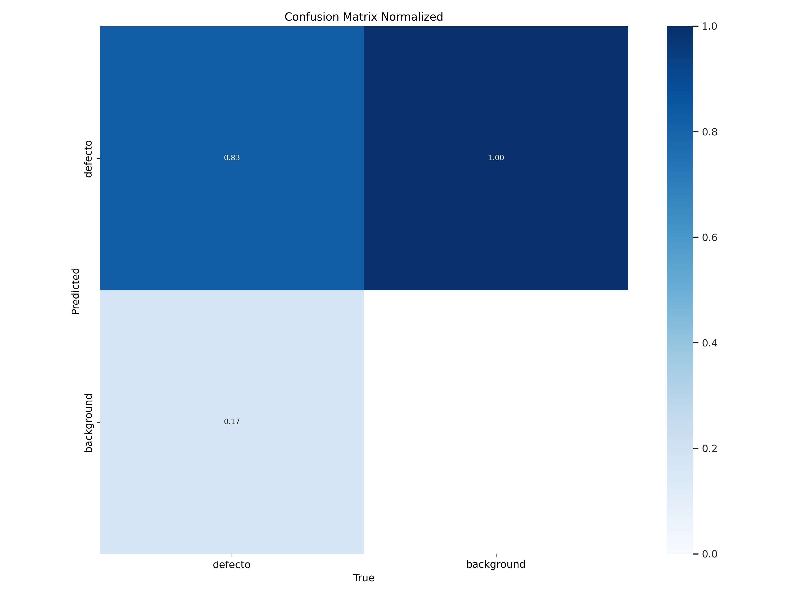
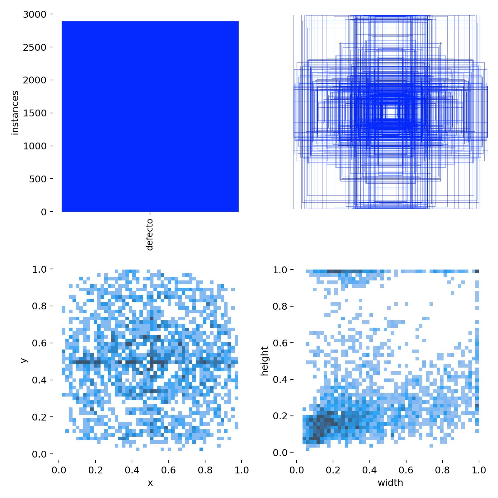
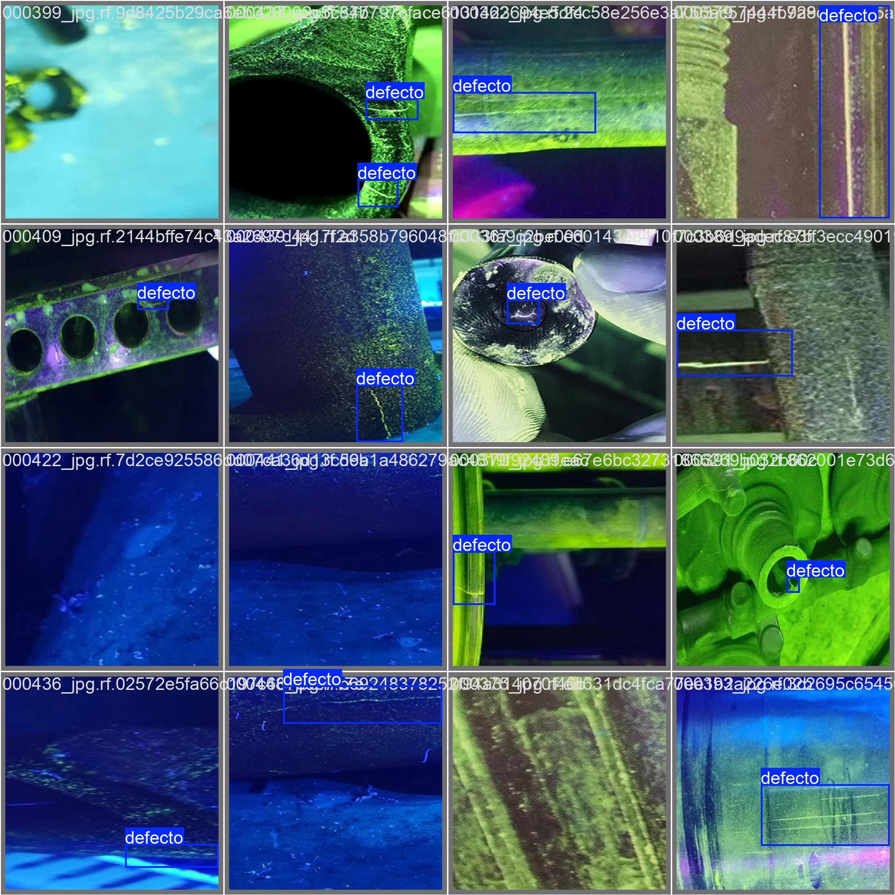

<div align="center">

# Fluorescent Penetrant Inspection

**A YOLO11l detector for liquid penetrant testing (FPI / PT / LPI).**

[](https://github.com/ultralytics/ultralytics)
[](#results)
[](https://huggingface.co/jparedesDS/fluorescent-penetrant-inspection)

[← Back to the model zoo](../../README.md) · [Full catalog](../../docs/model-zoo.md)

</div>

---

## Overview

Liquid penetrant inspection is a non-destructive testing method for finding surface-breaking defects in non-porous materials. A penetrant is applied to the part, excess is removed, a developer draws the penetrant out of discontinuities, and the inspector looks for indications — often under UV light in the fluorescent variant (FPI).

The visual signal is unusual: bright fluorescent indications on a dark surface, with strong glare, reflections and uneven illumination. This project trains a single-class YOLO11l detector to localize those indications.

> **Not a certified inspection system.** This is a research prototype. Qualification of penetrant inspection procedures, personnel and acceptance criteria remains with the responsible NDT organization.

## Model

| Property | Value |
|---|---|
| Architecture | YOLO11l |
| Weights | `yolo11l_LPI.pt` |
| Parameters | 25.3 M |
| GFLOPs | 86.6 |
| Classes | 1 |
| mAP@50 | **0.793** |
| mAP@50-95 | **0.379** |
| Validation split | 836 images / 752 instances |
| Hugging Face | [`jparedesDS/fluorescent-penetrant-inspection`](https://huggingface.co/jparedesDS/fluorescent-penetrant-inspection) |

The Hugging Face repository is gated (`auto`): access is granted after accepting the conditions on the model card.

## Class labels

| ID | Label | Meaning |
|:---:|---|---|
| 0 | `defecto` | Penetrant indication / defect |

## Results

| Class | Precision | Recall | mAP@50 | mAP@50-95 |
|---|---:|---:|---:|---:|
| **all** | **0.794** | **0.771** | **0.793** | **0.379** |

mAP@50 is reasonable, but the drop at mAP@50-95 shows that **box tightness** is the weak point: fluorescent indications bleed and glow, so the visible region is larger and softer than the actual discontinuity. If you only need to flag suspicious regions, evaluate at IoU 0.50; if you need precise defect sizing, this checkpoint is not enough.

### Training curves


### Confusion matrix



### Label distribution



### Predictions



## Quick start

```bash
hf download jparedesDS/fluorescent-penetrant-inspection \
  yolo11l_LPI.pt --local-dir weights
```

```python
from ultralytics import YOLO

model = YOLO("weights/yolo11l_LPI.pt")
results = model.predict("inspection.jpg", conf=0.25, save=True, device=0)
```

## Dataset notes

- Source: fluorescent penetrant inspection imagery.
- One class (`defecto`).
- Strong class imbalance is likely: 836 validation images but only 752 indications.
- Glare, UV illumination and surface reflections are the main confounders.
- Dataset images are not distributed.

## License

MIT. See the [repository license](../../LICENSE).
