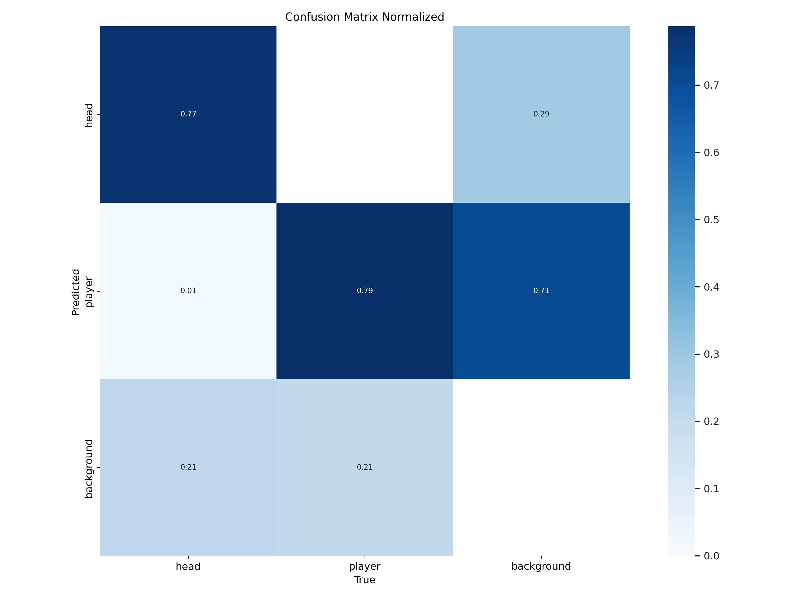

<div align="center">

# Fortnite Player Detection

**A YOLO11m detector for player and head localization in Fortnite.**

[](https://github.com/ultralytics/ultralytics)
[](#results)
[](https://huggingface.co/jparedesDS/fortnite-yolo11m)

[← Back to the model zoo](../../README.md) · [Full catalog](../../docs/model-zoo.md)

</div>

---

## Overview

A YOLO11m checkpoint trained to detect Fortnite players and their heads. Fortnite's third-person camera, building mechanics and bright art style make it visually very different from tactical shooters, which is why it deserves its own detector rather than reusing the CS2 or Valorant weights.

## Model

| Property | Value |
|---|---|
| Architecture | YOLO11m |
| Weights | `fortnite-yolo11m.pt` |
| Parameters | 20.0 M |
| GFLOPs | 67.7 |
| Classes | 2 |
| mAP@50 | **0.828** |
| mAP@50-95 | **0.668** |
| Validation split | 1,014 images / 2,097 instances |
| Hugging Face | [`jparedesDS/fortnite-yolo11m`](https://huggingface.co/jparedesDS/fortnite-yolo11m) |

The Hugging Face repository is gated (`manual`): request access from the model card.

## Class labels

| ID | Label | Meaning |
|:---:|---|---|
| 0 | `head` | Player head |
| 1 | `player` | Player body |

## Results

| Class | Precision | Recall | mAP@50 | mAP@50-95 |
|---|---:|---:|---:|---:|
| **all** | **0.933** | **0.739** | **0.828** | **0.668** |
| `head` | 0.947 | 0.738 | 0.825 | 0.664 |
| `player` | 0.919 | 0.740 | 0.831 | 0.673 |

Recall is the limiting metric here: players are often partially hidden behind builds, vegetation or vehicles. If your application favors recall over precision, lower the confidence threshold at inference time.

### Training curves


### Confusion matrix



### Label distribution


### Predictions


## Quick start

```bash
hf download jparedesDS/fortnite-yolo11m fortnite-yolo11m.pt --local-dir weights
```

```python
from ultralytics import YOLO

model = YOLO("weights/fortnite-yolo11m.pt")
results = model.predict("frame.jpg", conf=0.25, save=True, device=0)
```

## Dataset notes

- Source: Fortnite gameplay frames, third-person view.
- Two classes, YOLO-format boxes.
- Wide variation in skins, biomes, build fights and camera distance.
- Dataset images are not distributed.

## License

MIT. See the [repository license](../../LICENSE).
