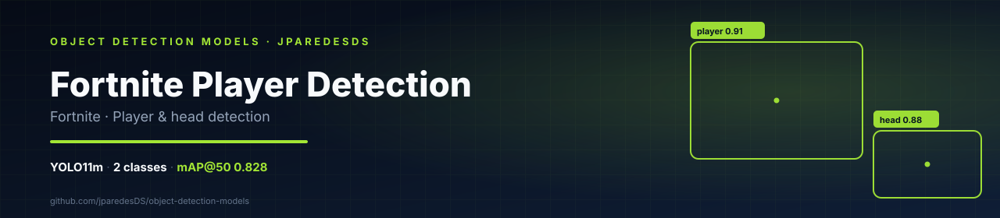
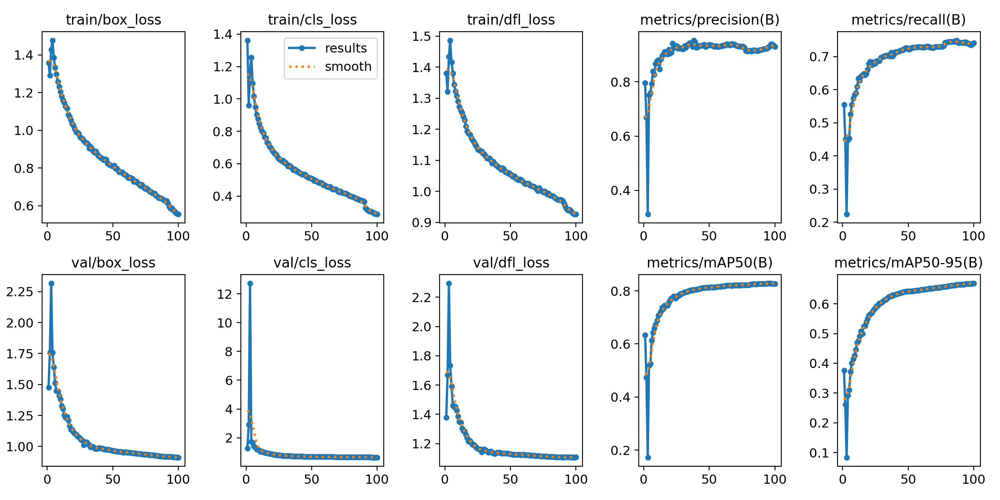
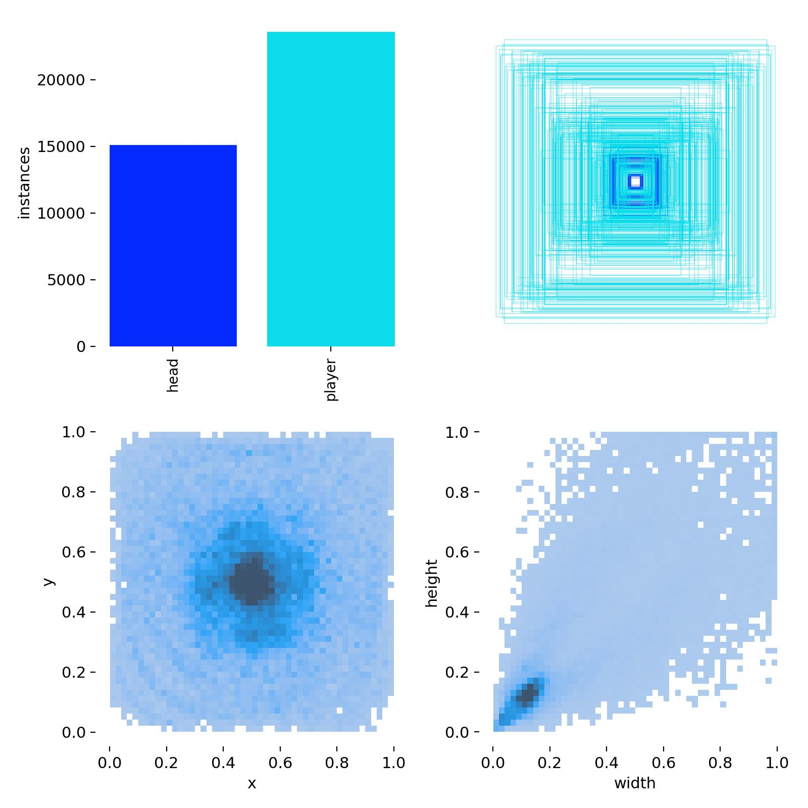
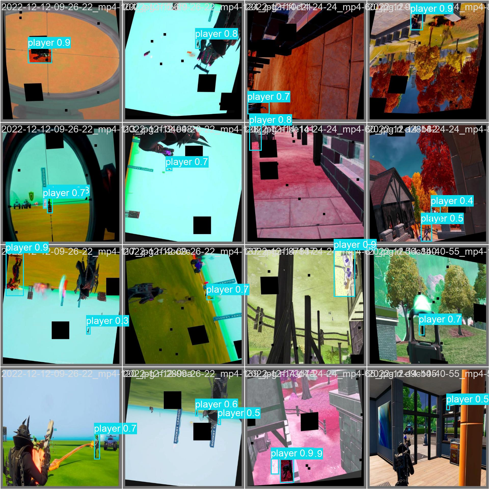

<div align="center">



# Fortnite Player Detection

**A YOLO11m detector for player and head localization in Fortnite.**

[](https://github.com/ultralytics/ultralytics)
[](#results)
[](#class-labels)
[](https://huggingface.co/jparedesDS/fortnite-yolo11m)

[← Model zoo](../../README.md) · [Full catalog](../../docs/model-zoo.md) · [Training guide](../../docs/training-guide.md)

</div>

---

## At a glance

| Property | Value |
|---|---|
| **Task** | Player and head localization in Fortnite |
| **Architecture** | YOLO11m |
| **Checkpoint** | `fortnite-yolo11m.pt` |
| **Classes** | `head`, `player` |
| **Parameters** | 20.0 M |
| **GFLOPs** | 67.7 |
| **mAP@50** | **0.828** |
| **mAP@50-95** | **0.668** |
| **Validation split** | 1,014 images / 2,097 instances |
| **Model card** | [`jparedesDS/fortnite-yolo11m`](https://huggingface.co/jparedesDS/fortnite-yolo11m) |

The Hugging Face repository is gated: request access from the model card and authenticate with `hf auth login` before downloading.

## Overview

A YOLO11m checkpoint trained to detect Fortnite players and their heads. Fortnite's third-person camera, building mechanics and bright, stylized art direction make it visually very different from tactical shooters, which is why it deserves its own detector rather than reusing the CS2 or Valorant weights.

The two-class formulation keeps annotation fast and gives downstream trackers a clean separation between the player silhouette and the head region. It is also the most-liked checkpoint in this zoo, which makes it the natural entry point for anyone experimenting with game player detection.

## Highlights

- **Body and head classes** in a single forward pass.
- **0.828 mAP@50** and **0.668 mAP@50-95** on a validation split of 1,014 images.
- **Balanced per-class scores** — head and player differ by only 0.006 mAP@50.
- **YOLO11m** is small enough for real-time inference on a single consumer GPU.
- The most popular model in the collection on Hugging Face.

## Class labels

| ID | Label | Meaning |
|:---:|---|---|
| 0 | `head` | Player head |
| 1 | `player` | Player body |

## Results

| Class | Precision | Recall | mAP@50 | mAP@50-95 |
|---|---:|---:|---:|---:|
| **all** | **0.933** | **0.739** | **0.828** | **0.668** |
| `head` | 0.947 | 0.738 | 0.825 | 0.664 |
| `player` | 0.919 | 0.740 | 0.831 | 0.673 |

Precision is high and recall is the limiting metric: players are often partially hidden behind builds, vegetation, vehicles or the edge of the frame. If your application favors recall over precision, lower the confidence threshold at inference time and add temporal smoothing.

### Training results and curves

<p align="center">
  
  
</p>

### Label distribution

<p align="center">
  
</p>

### Predictions

<p align="center">
  
</p>

## Quick start

```bash
hf download jparedesDS/fortnite-yolo11m fortnite-yolo11m.pt --local-dir weights
```

```python
from ultralytics import YOLO

model = YOLO("weights/fortnite-yolo11m.pt")
results = model.predict("frame.jpg", conf=0.25, save=True, device=0)

for box in results[0].boxes:
    print(model.names[int(box.cls)], float(box.conf))
```

### Tracking players across frames

Pair the detector with a multi-object tracker to obtain identities:

```python
results = model.track("clip.mp4", conf=0.3, tracker="bytetrack.yaml", persist=True)
```

## Dataset

- **Source:** Fortnite gameplay frames, third-person view.
- **Format:** YOLO boxes, two classes.
- **Variation:** wide range of skins, biomes, build fights, vehicles and camera distances.
- **Occlusion:** a large share of players are partially occluded, which explains the precision/recall gap.
- **Distribution:** dataset images are **not** distributed. The class definitions and metrics are published so the dataset can be rebuilt.
- **Quality control:** labels were audited with [`check_labels.py`](../../tools/annotations/check_labels.py) before training.

## Related projects

- [CS2 Player Detection](../cs2-players-detection/) — body/head detection in Counter-Strike 2.
- [Valorant Player Detection](../valorant-players-detection/) — body/head detection in Valorant.
- [Overwatch 2 Detection](../overwatch2-players-detection/) — a head-only detector for a hero shooter.
- [Full model zoo](../../docs/model-zoo.md) — every checkpoint and class list.

## License

MIT. See the [repository license](../../LICENSE).
