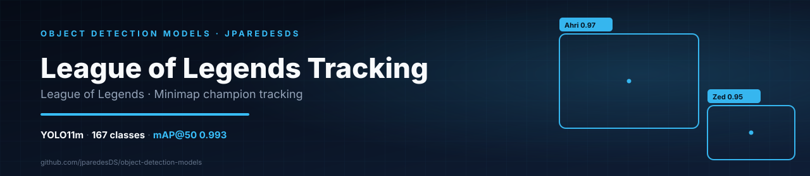
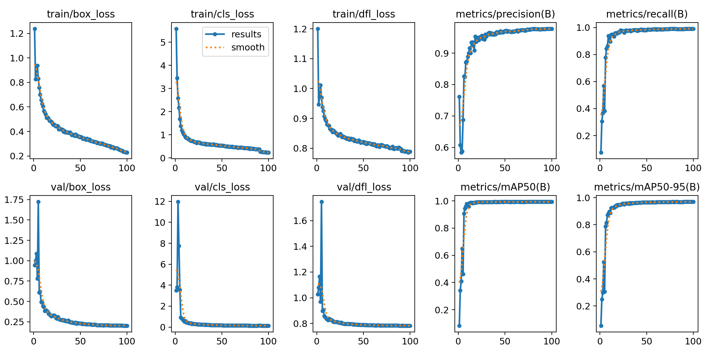
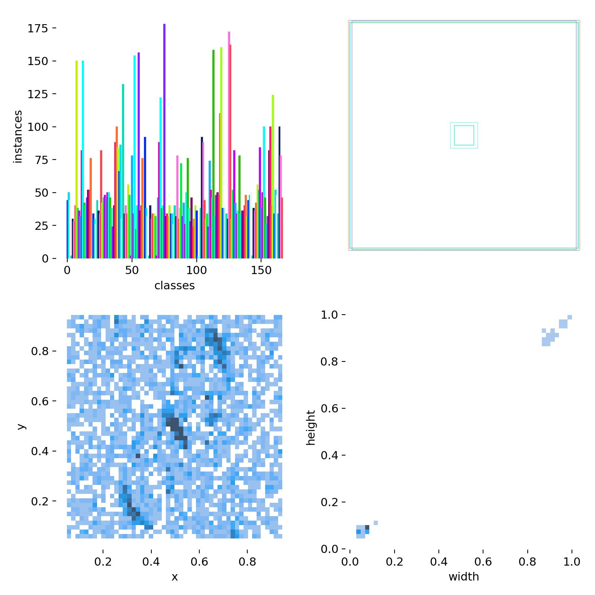
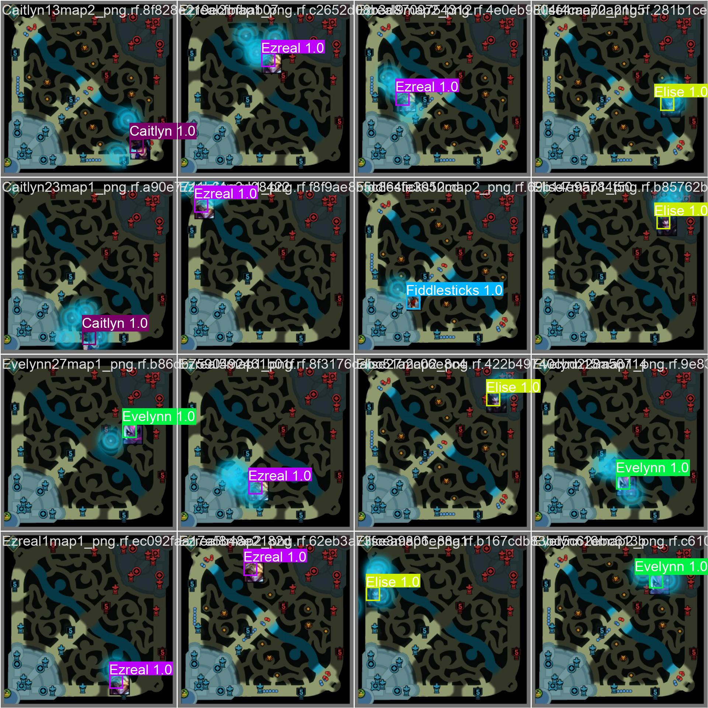

<div align="center">



# League of Legends Champion Tracking

**A 167-class YOLO11m detector for champion icons on the League of Legends minimap.**

[](https://github.com/ultralytics/ultralytics)
[](#results)
[](#class-labels)
[](https://huggingface.co/jparedesDS/lol-map-tracking-object-detection)

[← Model zoo](../../README.md) · [Full catalog](../../docs/model-zoo.md) · [Training guide](../../docs/training-guide.md)

</div>

---

## At a glance

| Property | Value |
|---|---|
| **Task** | Champion icon detection on the League of Legends minimap |
| **Architecture** | YOLO11m |
| **Checkpoint** | `yolo11m_lol-tracking.pt` |
| **Classes** | 167 (one per champion) |
| **Parameters** | 20.2 M |
| **GFLOPs** | 68.4 |
| **mAP@50** | **0.993** |
| **mAP@50-95** | **0.970** |
| **Validation split** | 822 images / 1,058 instances |
| **Model card** | [`jparedesDS/lol-map-tracking-object-detection`](https://huggingface.co/jparedesDS/lol-map-tracking-object-detection) |

The Hugging Face repository is gated: accept the conditions on the model card and authenticate with `hf auth login` before downloading.

## Overview

The minimap is the richest structured signal in League of Legends: it shows the position of every visible champion, which is exactly what tracking and rotation-analysis pipelines need.

This YOLO11m checkpoint detects **champion icons** on the minimap, with one class per champion (167 classes). Combined with a multi-object tracker, it produces per-champion trajectories that can feed map-control, rotation, jungle-path or draft-analysis models.

The detector is trained for the minimap only — not for the main game view. That narrow domain is deliberate: minimap icons are small and highly consistent, so a compact model can reach very high accuracy while staying fast enough to run on every frame.

## Highlights

- **167 champion classes** in a single checkpoint, from `Aatrox` to `Zyra`.
- **0.993 mAP@50** and **0.970 mAP@50-95** on the recorded validation split.
- **Minimap-specific**: handles the fixed icon style, scale and UI chrome of the map.
- **Tracking-ready**: pair with ByteTrack or BoT-SORT for per-champion trajectories.
- **20.2 M parameters** — real-time on a single consumer GPU.

## Class labels

One class per champion icon. The full list of 167 labels is in the [model zoo catalog](../../docs/model-zoo.md#league-of-legends-167-classes).

A representative sample of the labels:

| Label | Label | Label | Label |
|---|---|---|---|
| `Aatrox` | `Ahri` | `Akali` | `Akshan` |
| `Alistar` | `Amumu` | `Anivia` | `Annie` |
| `Aphelios` | `Ashe` | `AurelionSol` | `Azir` |
| … | … | … | … |
| `Yasuo` | `Yone` | `Zed` | `Zyra` |

A few duplicate spellings are inherited from the annotation pipeline (`ChoGath`/`Chogath`, `Jayce`/`Jaycew`, `VelKoz`/`Velkoz`, `RekSai`/`Reksai`). They are preserved so the class IDs stay compatible with the published checkpoint.

## Results

| Class | Precision | Recall | mAP@50 | mAP@50-95 |
|---|---:|---:|---:|---:|
| **all** | **0.978** | **0.991** | **0.993** | **0.970** |

Icons are small but highly consistent, which is why the detector reaches such a high mAP. The hard cases are overlapping icons, fog-of-war transitions, the few champions with visually similar portraits, and frames where the minimap is partially covered by the scoreboard or a camera overlay.

### Training results and curves

<p align="center">
  
  
</p>

### Label distribution

<p align="center">
  
</p>

### Predictions

<p align="center">
  
</p>

## Quick start

```bash
hf download jparedesDS/lol-map-tracking-object-detection \
  yolo11m_lol-tracking.pt --local-dir weights
```

```python
from ultralytics import YOLO

model = YOLO("weights/yolo11m_lol-tracking.pt")
results = model.predict("minimap.png", conf=0.5, save=True, device=0)

for box in results[0].boxes:
    print(model.names[int(box.cls)], box.xyxy.tolist())
```

### Tracking champions across a match

Crop the minimap to a fixed region, then run the tracker on the resulting clip:

```python
results = model.track(
    source="minimap.mp4",
    conf=0.5,
    tracker="bytetrack.yaml",
    persist=True,
)

for result in results:
    for box in result.boxes:
        if box.id is not None:
            print(int(box.id), model.names[int(box.cls)])
```

Keep the minimap crop stable across frames: a moving crop breaks tracker associations and makes trajectories incomparable between matches.

## Dataset

- **Source:** League of Legends minimap crops from recorded matches.
- **Format:** YOLO boxes, 167 champion icon classes.
- **Challenges:** tiny icons, overlapping champions, fog of war, UI overlays and visually similar portraits.
- **Distribution:** dataset images are **not** distributed. The class list and metrics are documented so an equivalent dataset can be rebuilt.
- **Quality control:** annotations were audited with [`check_labels.py`](../../tools/annotations/check_labels.py) before training.

## Downstream use

The detector answers *which champion is where* on the minimap. Useful next steps:

- **Map control:** aggregate positions into zone-occupancy heatmaps.
- **Rotation analysis:** measure lane-to-lane travel times and response patterns.
- **Jungle tracking:** detect pathing deviations from expected routes.
- **Draft analysis:** correlate champion composition with spatial behavior.

## Related projects

- [Full model zoo](../../docs/model-zoo.md) — every checkpoint, parameter count and class list.
- [Training guide](../../docs/training-guide.md) — dataset layout, training and evaluation workflow.

## License

MIT. See the [repository license](../../LICENSE).
