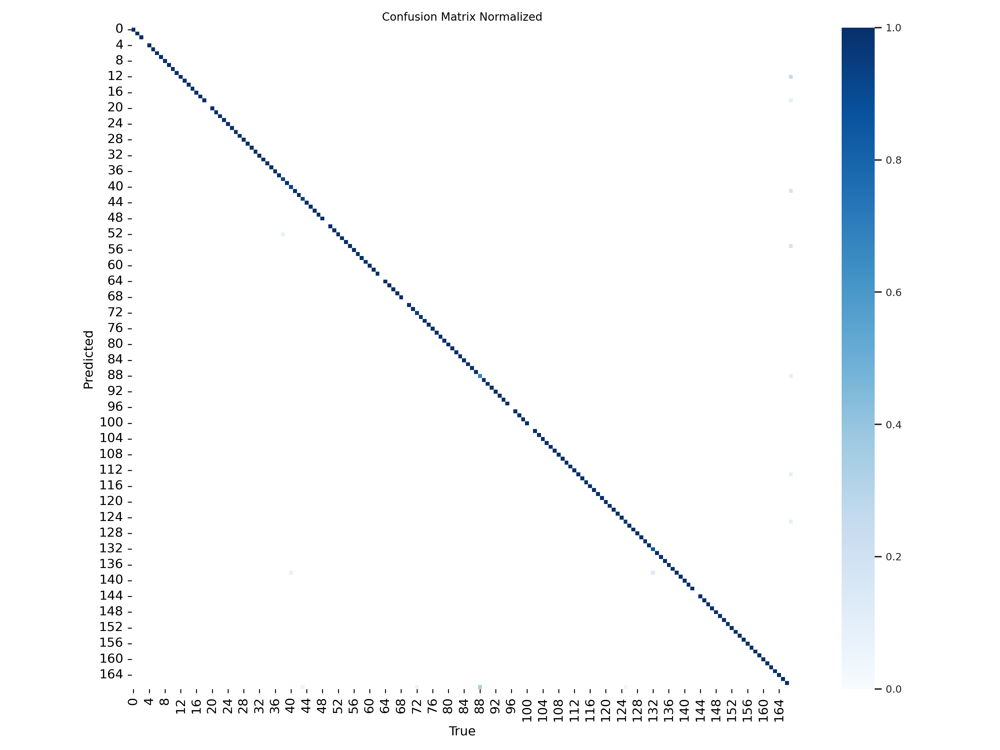

<div align="center">

# League of Legends Champion Tracking

**A 167-class YOLO11m detector for champion icons on the League of Legends minimap.**

[](https://github.com/ultralytics/ultralytics)
[](#results)
[](#class-labels)
[](https://huggingface.co/jparedesDS/lol-map-tracking-object-detection)

[← Back to the model zoo](../../README.md) · [Full catalog](../../docs/model-zoo.md)

</div>

---

## Overview

The minimap is the richest structured signal in League of Legends: it shows the position of every visible champion, which is exactly what tracking and rotation-analysis pipelines need.

This YOLO11m checkpoint detects **champion icons** on the minimap, with one class per champion (167 classes). Combined with a tracker, it produces per-champion trajectories that can feed map-control, rotation or draft-analysis models.

## Model

| Property | Value |
|---|---|
| Architecture | YOLO11m |
| Weights | `yolo11m_lol-tracking.pt` |
| Parameters | 20.2 M |
| GFLOPs | 68.4 |
| Classes | 167 |
| mAP@50 | **0.993** |
| mAP@50-95 | **0.970** |
| Validation split | 822 images / 1,058 instances |
| Hugging Face | [`jparedesDS/lol-map-tracking-object-detection`](https://huggingface.co/jparedesDS/lol-map-tracking-object-detection) |

The Hugging Face repository is gated (`auto`): access is granted after accepting the conditions on the model card.

## Class labels

One class per champion icon, from `Aatrox` to `Zyra`. The full list of 167 labels is in the [model zoo catalog](../../docs/model-zoo.md#league-of-legends-167-classes).

A few duplicate spellings are inherited from the annotation pipeline (`ChoGath`/`Chogath`, `Jayce`/`Jaycew`, `VelKoz`/`Velkoz`, `RekSai`/`Reksai`). They are preserved to keep class IDs compatible with the published checkpoint.

## Results

| Class | Precision | Recall | mAP@50 | mAP@50-95 |
|---|---:|---:|---:|---:|
| **all** | **0.978** | **0.991** | **0.993** | **0.970** |

Icons are small but highly consistent, which is why the detector reaches such a high mAP. The hard cases are overlapping icons, fog-of-war transitions and the few champions with visually similar portraits.

### Training curves


### Confusion matrix



### Label distribution


### Predictions


## Quick start

```bash
hf download jparedesDS/lol-map-tracking-object-detection \
  yolo11m_lol-tracking.pt --local-dir weights
```

```python
from ultralytics import YOLO

model = YOLO("weights/yolo11m_lol-tracking.pt")
results = model.predict("minimap.png", conf=0.5, save=True, device=0)

for box in results[0].boxes:
    print(model.names[int(box.cls)], box.xyxy.tolist())
```

## Dataset notes

- Source: League of Legends minimap crops.
- 167 champion icon classes.
- The detector is designed for the minimap, not for the main game view.
- Dataset images are not distributed.
- For tracking, pair the detector with a multi-object tracker (ByteTrack or BoT-SORT) and a fixed minimap region.

## License

MIT. See the [repository license](../../LICENSE).
