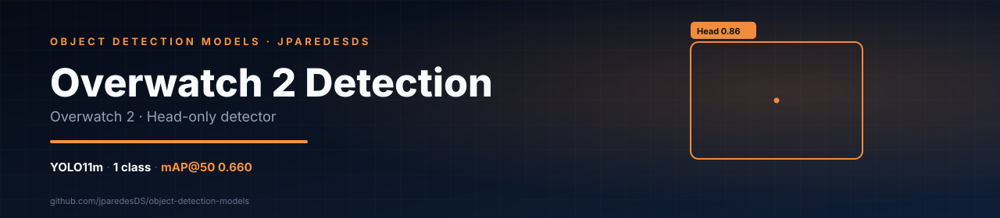
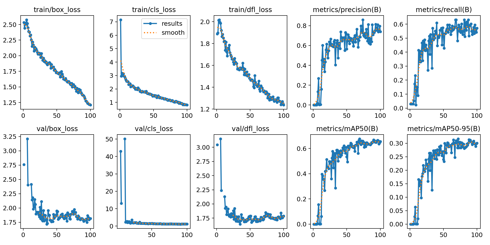
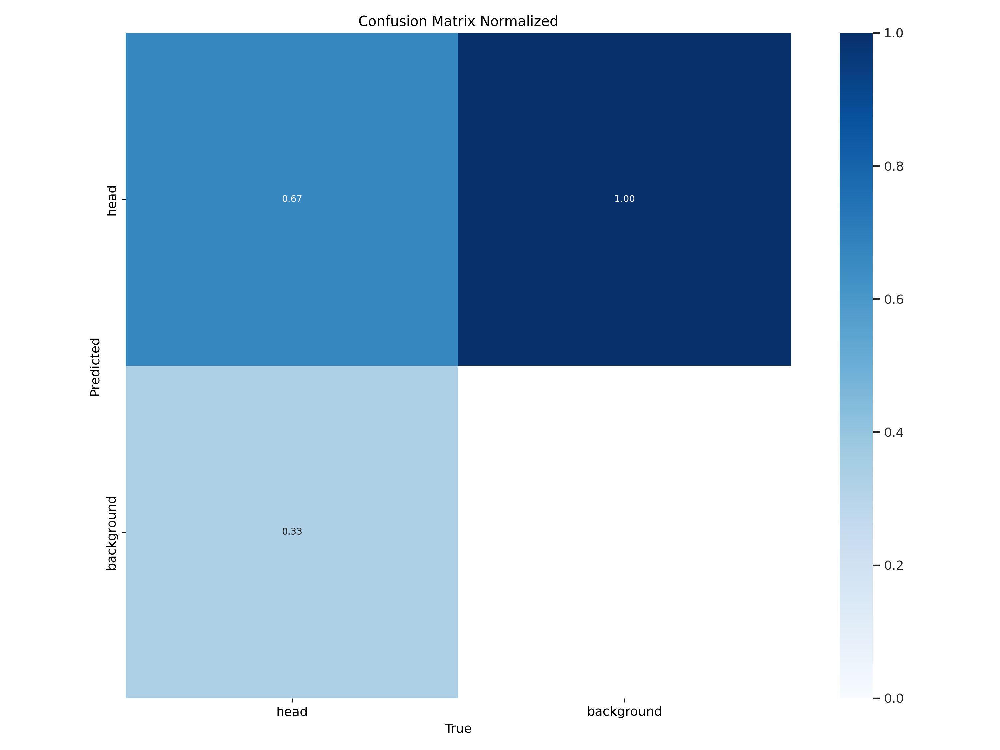

<div align="center">



# Overwatch 2 Detection

**A YOLO11m head-only detector for Overwatch 2.**

[](https://github.com/ultralytics/ultralytics)
[](#results)
[](#class-labels)
[](https://huggingface.co/jparedesDS/ow2-yolo11m)

[← Model zoo](../../README.md) · [Full catalog](../../docs/model-zoo.md) · [Training guide](../../docs/training-guide.md)

</div>

---

## At a glance

| Property | Value |
|---|---|
| **Task** | Head localization in Overwatch 2 |
| **Architecture** | YOLO11m |
| **Checkpoint** | `ow2-yolo11m.pt` |
| **Classes** | `Head` |
| **Parameters** | 20.0 M |
| **GFLOPs** | 67.6 |
| **mAP@50** | **0.660** |
| **mAP@50-95** | **0.317** |
| **Validation split** | 273 images / 133 instances |
| **Model card** | [`jparedesDS/ow2-yolo11m`](https://huggingface.co/jparedesDS/ow2-yolo11m) |

The Hugging Face repository is gated: request access from the model card and authenticate with `hf auth login` before downloading.

> **Naming note:** earlier documentation described this checkpoint as YOLO11l. The published weights are **YOLO11m** (~20.0 M parameters). The model card is authoritative.

## Overview

A single-class detector focused on heads in Overwatch 2. The project explores how far a compact, single-class formulation can go in a game with extreme visual diversity: 40+ heroes, bright ability effects, shields, projectiles and constant camera motion.

This is the least mature detector in the zoo, and its metrics are published as-is. Negative results and hard benchmarks are just as useful as polished ones: the gap between this checkpoint and the Fortnite or Valorant detectors is a concrete illustration of how much visual diversity and validation-set size affect small-object detection.

## Highlights

- **Head-only formulation** — one class, no body boxes, minimal annotation ambiguity.
- **YOLO11m** keeps inference cheap while leaving room for a harder visual domain.
- **Honest benchmark** of a small, hero-diverse dataset rather than a cherry-picked result.
- A clear baseline for future work: more heroes, more frames and a larger validation split.

## Class labels

| ID | Label | Meaning |
|:---:|---|---|
| 0 | `Head` | Hero head |

## Results

| Class | Precision | Recall | mAP@50 | mAP@50-95 |
|---|---:|---:|---:|---:|
| **all** | **0.742** | **0.563** | **0.660** | **0.317** |

The validation split contains only **133 head instances across 273 images**, so the estimate is noisy and explains part of the gap with the other projects. Heads also change shape dramatically between heroes, and bright ability effects frequently cover them. A larger, hero-balanced dataset is the next step.

### Training results and curves

<p align="center">
  
  
</p>

### Label distribution

<p align="center">
  
</p>

### Validation batch

<p align="center">
  
</p>

## Quick start

```bash
hf download jparedesDS/ow2-yolo11m ow2-yolo11m.pt --local-dir weights
```

```python
from ultralytics import YOLO

model = YOLO("weights/ow2-yolo11m.pt")
results = model.predict("frame.jpg", conf=0.3, save=True, device=0)

for box in results[0].boxes:
    print(model.names[int(box.cls)], float(box.conf))
```

Given the current recall, a confidence threshold around `0.2`–`0.3` is a reasonable starting point for exploration; tune it against your own footage.

## Dataset

- **Source:** Overwatch 2 gameplay frames covering multiple heroes and maps.
- **Format:** YOLO boxes, one class (`Head`).
- **Challenges:** hero silhouette diversity, shields, ability VFX, camera motion and frequent occlusion.
- **Distribution:** dataset images are **not** distributed.
- **Caveat:** the validation split is very small (133 instances). Treat the metrics as preliminary and re-evaluate on an independent, hero-balanced set before drawing conclusions.

## Roadmap

- Expand the dataset with more frames per hero and per map.
- Add a `body` class to study whether body context improves head recall.
- Evaluate per-hero metrics to identify the worst-performing silhouettes.
- Compare YOLO11m against a larger checkpoint once the dataset supports it.

## Related projects

- [Fortnite Player Detection](../fortnite-players-detection/) — body and head detection in a stylized third-person shooter.
- [Valorant Player Detection](../valorant-players-detection/) — body and head detection in a hero shooter.
- [CS2 Player Detection](../cs2-players-detection/) — body and head detection in a tactical shooter.
- [Full model zoo](../../docs/model-zoo.md) — every checkpoint and class list.

## License

MIT. See the [repository license](../../LICENSE).
