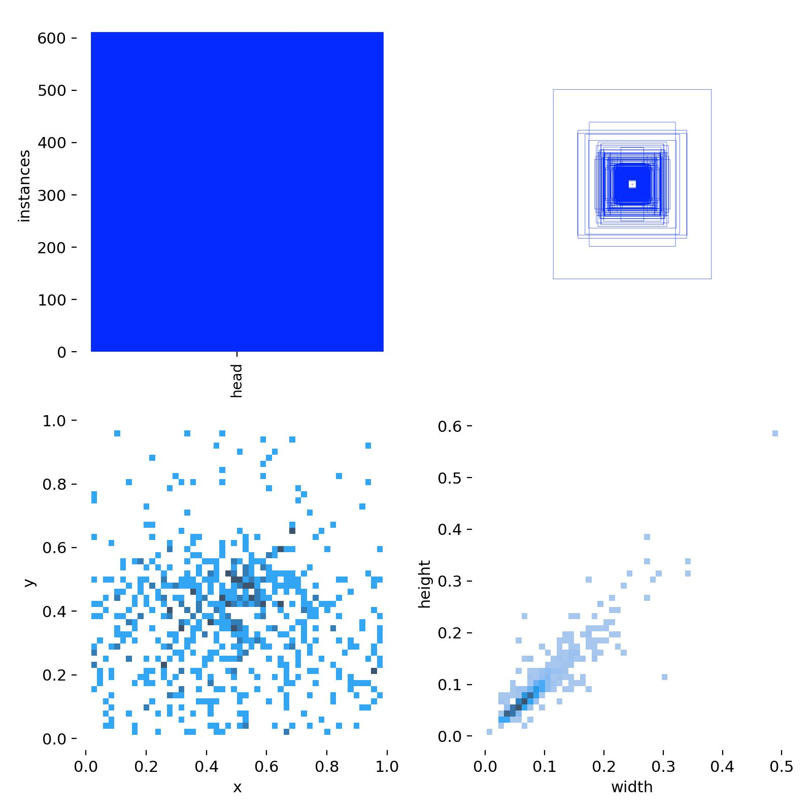
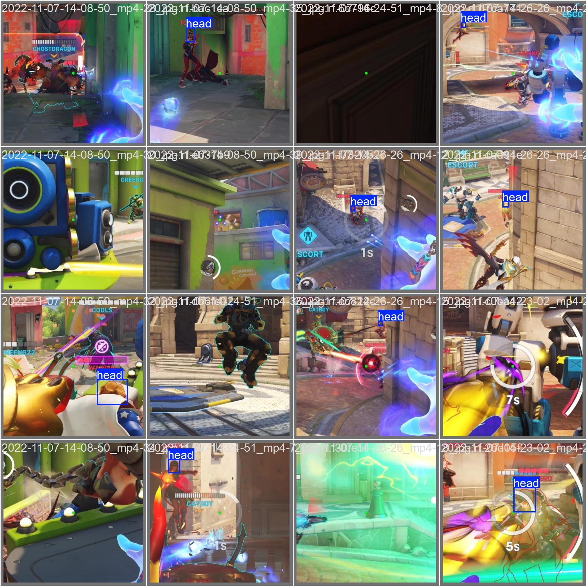

<div align="center">

# Overwatch 2 Detection

**A YOLO11m head detector for Overwatch 2.**

[](https://github.com/ultralytics/ultralytics)
[](#results)
[](https://huggingface.co/jparedesDS/ow2-yolo11m)

[← Back to the model zoo](../../README.md) · [Full catalog](../../docs/model-zoo.md)

</div>

---

## Overview

A single-class detector focused on heads in Overwatch 2. The project explores how far a compact, single-class formulation can go in a game with extreme visual diversity: 40+ heroes, bright ability effects, shields and frequent camera motion.

This is the least mature detector in the zoo. Its metrics are published as-is because negative results and hard benchmarks are just as useful as polished ones.

## Model

| Property | Value |
|---|---|
| Architecture | YOLO11m |
| Weights | `ow2-yolo11m.pt` |
| Parameters | 20.0 M |
| GFLOPs | 67.6 |
| Classes | 1 |
| mAP@50 | **0.660** |
| mAP@50-95 | **0.317** |
| Validation split | 273 images / 133 instances |
| Hugging Face | [`jparedesDS/ow2-yolo11m`](https://huggingface.co/jparedesDS/ow2-yolo11m) |

> **Naming note:** earlier documentation described this checkpoint as YOLO11l. The published weights are **YOLO11m** (~20.0 M parameters). The model card is authoritative.

The Hugging Face repository is gated (`manual`): request access from the model card.

## Class labels

| ID | Label | Meaning |
|:---:|---|---|
| 0 | `Head` | Hero head |

## Results

| Class | Precision | Recall | mAP@50 | mAP@50-95 |
|---|---:|---:|---:|---:|
| **all** | **0.742** | **0.563** | **0.660** | **0.317** |

The validation split has only 133 head instances, which makes the estimate noisy and explains part of the gap with the other projects. A larger, hero-balanced dataset is the next step.

### Training curves


### Confusion matrix


### Label distribution



### Predictions



## Quick start

```bash
hf download jparedesDS/ow2-yolo11m ow2-yolo11m.pt --local-dir weights
```

```python
from ultralytics import YOLO

model = YOLO("weights/ow2-yolo11m.pt")
results = model.predict("frame.jpg", conf=0.3, save=True, device=0)
```

## Dataset notes

- Source: Overwatch 2 gameplay frames.
- One class (`Head`).
- Very small validation split; results should be treated as preliminary.
- Dataset images are not distributed.

## License

MIT. See the [repository license](../../LICENSE).
