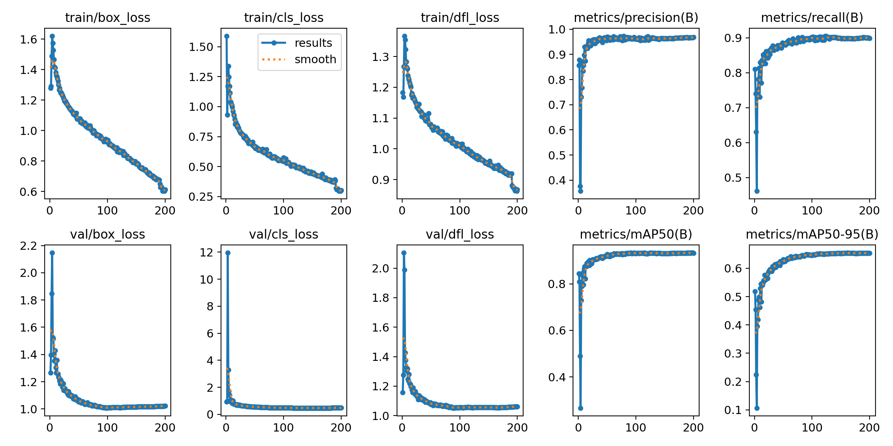
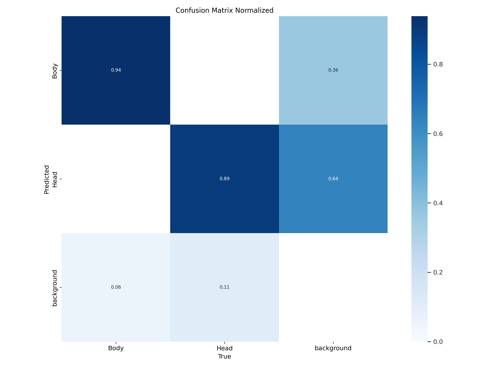

<div align="center">

# Valorant Player Detection

**YOLOv10b and YOLO11m detectors for body and head localization in Valorant.**

[](https://github.com/ultralytics/ultralytics)
[](#results)
[](https://huggingface.co/jparedesDS)

[← Back to the model zoo](../../README.md) · [Full catalog](../../docs/model-zoo.md)

</div>

---

## Overview

Two checkpoints trained to detect player bodies and heads in Valorant gameplay. The two-class formulation (`Body`, `Head`) keeps the annotation fast and gives downstream trackers a clean separation between the player silhouette and the head region.

## Models

| Model | Architecture | Weights | Params | GFLOPs | mAP@50 | mAP@50-95 | Hugging Face |
|---|---|---|:---:|:---:|:---:|:---:|---|
| Valorant · YOLOv10b | YOLOv10b | `yolov10b_vlr.pt` | 20.4 M | 97.9 | **0.925** | **0.631** | [`valorant-yolov10b`](https://huggingface.co/jparedesDS/valorant-yolov10b) |
| Valorant · YOLO11m | YOLO11m | `vlr-yolo11m.pt` | — | — | — | — | [`valorant-yolo11m`](https://huggingface.co/jparedesDS/valorant-yolo11m) |

Both repositories are gated on Hugging Face: accept the conditions on the model card and authenticate with `hf auth login`.

## Class labels

| ID | Label | Meaning |
|:---:|---|---|
| 0 | `Body` | Player body |
| 1 | `Head` | Player head |

## Results

Metrics for the YOLOv10b checkpoint on its validation split (999 images, 2,016 instances):

| Class | Precision | Recall | mAP@50 | mAP@50-95 |
|---|---:|---:|---:|---:|
| **all** | **0.959** | **0.886** | **0.925** | **0.631** |
| `Body` | 0.969 | 0.914 | 0.955 | 0.760 |
| `Head` | 0.948 | 0.857 | 0.896 | 0.503 |

The gap between body and head mAP@50-95 is the usual small-object problem: heads occupy few pixels and are frequently occluded by weapons, UI elements or other players.

### Training curves



### Confusion matrix



### Label distribution


### Predictions


## Quick start

```bash
hf download jparedesDS/valorant-yolov10b yolov10b_vlr.pt --local-dir weights
```

```python
from ultralytics import YOLO

model = YOLO("weights/yolov10b_vlr.pt")
results = model.predict("frame.jpg", conf=0.25, save=True, device=0)
```

## Dataset notes

- Source: Valorant gameplay frames at 16:9.
- Two classes, YOLO-format boxes.
- Variety of agents, skins, maps and lighting conditions.
- Dataset images are not distributed.

## License

MIT. See the [repository license](../../LICENSE).
