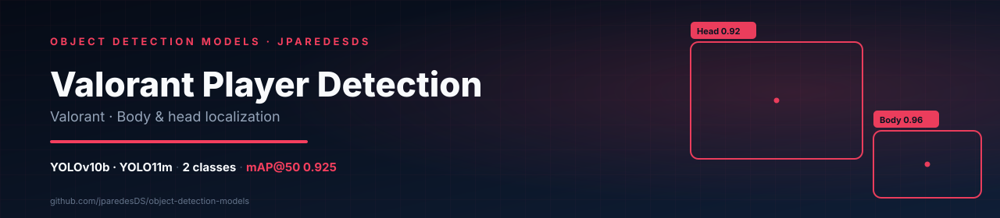
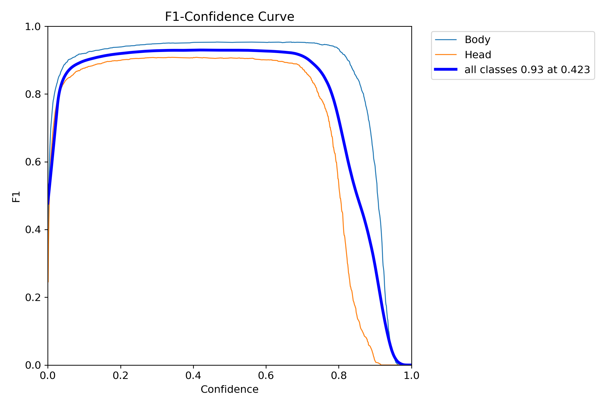
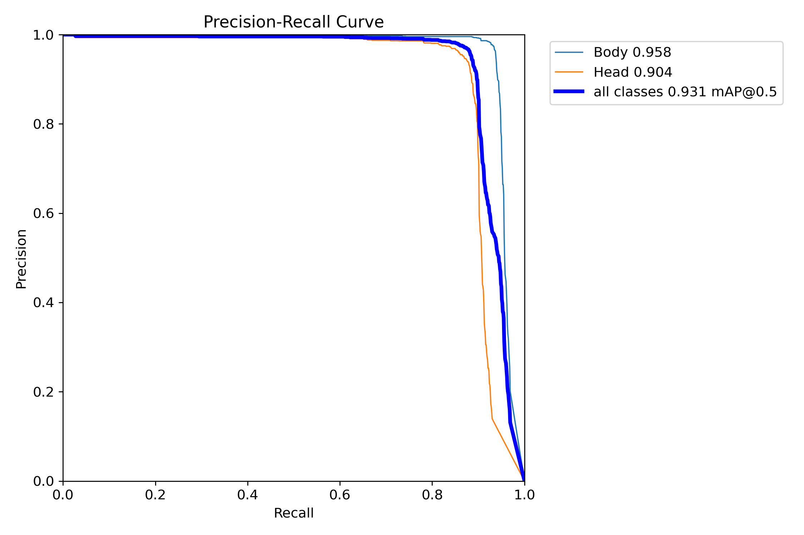
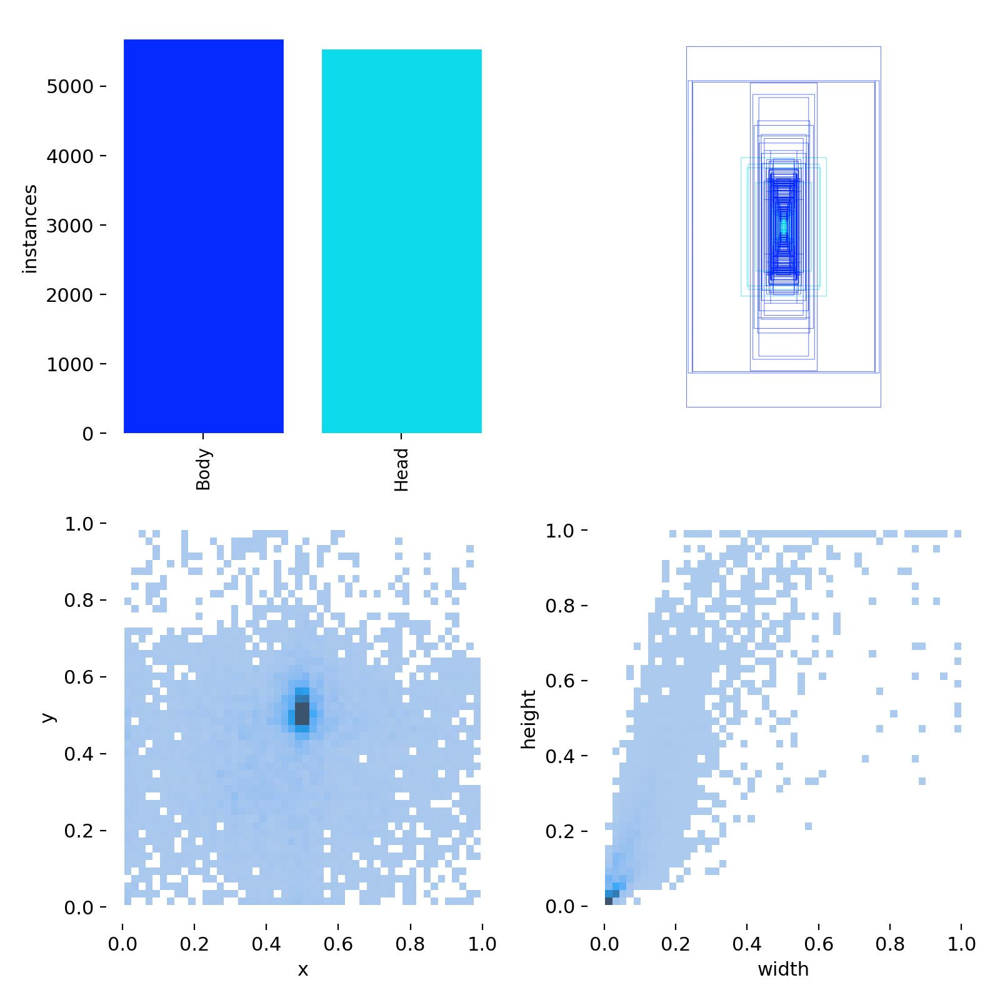
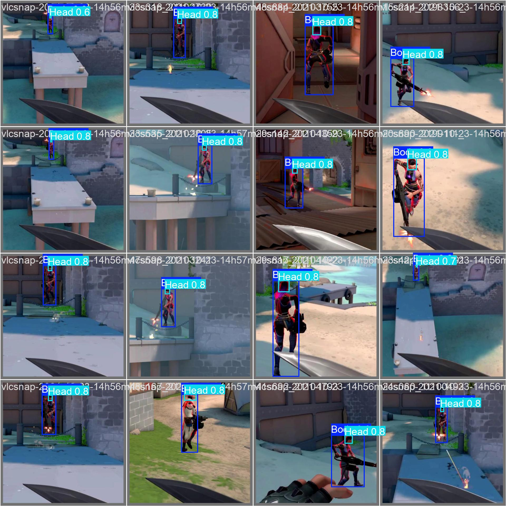

<div align="center">



# Valorant Player Detection

**YOLOv10b and YOLO11m detectors for body and head localization in Valorant.**

[](https://github.com/ultralytics/ultralytics)
[](#results)
[](#class-labels)
[](https://huggingface.co/jparedesDS)

[← Model zoo](../../README.md) · [Full catalog](../../docs/model-zoo.md) · [Training guide](../../docs/training-guide.md)

</div>

---

## At a glance

| Property | Value |
|---|---|
| **Task** | Player body and head localization in Valorant |
| **Architectures** | YOLOv10b, YOLO11m |
| **Checkpoints** | 2 |
| **Classes** | `Body`, `Head` |
| **Best mAP@50** | **0.931** (YOLO11m) |
| **Best mAP@50-95** | **0.655** (YOLO11m) |
| **Best checkpoint** | `vlr-yolo11m.pt` |
| **Validation split** | 999 images / 2,016 instances |
| **Model cards** | [`valorant-yolov10b`](https://huggingface.co/jparedesDS/valorant-yolov10b) · [`valorant-yolo11m`](https://huggingface.co/jparedesDS/valorant-yolo11m) |

Both Hugging Face repositories are gated: accept the conditions on the model card and authenticate with `hf auth login`.

## Overview

Two checkpoints trained to detect player bodies and heads in Valorant gameplay. The two-class formulation keeps annotation fast and gives downstream trackers a clean separation between the player silhouette and the head region.

Valorant's visual language — saturated abilities, unusual agent silhouettes and heavy UI — is different enough from other tactical shooters that reusing a CS2 checkpoint is not a good shortcut. The dataset was annotated specifically for this game.

## Models

| Model | Architecture | Weights | Params | GFLOPs | mAP@50 | mAP@50-95 | Hugging Face |
|---|---|---|:---:|:---:|:---:|:---:|---|
| Valorant · YOLOv10b | YOLOv10b | `yolov10b_vlr.pt` | 20.4 M | 97.9 | 0.925 | 0.631 | [`valorant-yolov10b`](https://huggingface.co/jparedesDS/valorant-yolov10b) |
| Valorant · YOLO11m | YOLO11m | `vlr-yolo11m.pt` | 20.0 M | 67.7 | **0.931** | **0.655** | [`valorant-yolo11m`](https://huggingface.co/jparedesDS/valorant-yolo11m) |

## Class labels

| ID | Label | Meaning |
|:---:|---|---|
| 0 | `Body` | Player body |
| 1 | `Head` | Player head |

## Results

Metrics for the **YOLO11m** checkpoint on its validation split (999 images, 2,016 instances):

| Class | Precision | Recall | mAP@50 | mAP@50-95 |
|---|---:|---:|---:|---:|
| **all** | **0.963** | **0.898** | **0.931** | **0.655** |
| `Body` | 0.971 | 0.935 | 0.958 | 0.791 |
| `Head` | 0.955 | 0.862 | 0.904 | 0.519 |

The gap between body and head mAP@50-95 is the usual small-object problem: heads occupy few pixels and are frequently occluded by weapons, UI elements or other players.

<details>
<summary><strong>YOLOv10b per-class metrics</strong> (same validation split)</summary>

| Class | Precision | Recall | mAP@50 | mAP@50-95 |
|---|---:|---:|---:|---:|
| **all** | **0.959** | **0.886** | **0.925** | **0.631** |
| `Body` | 0.969 | 0.914 | 0.955 | 0.760 |
| `Head` | 0.948 | 0.857 | 0.896 | 0.503 |

</details>

> YOLO11m improves on YOLOv10b across every metric while using fewer GFLOPs (67.7 vs 97.9), making it the recommended checkpoint.

### Training results and curves (YOLOv10b run)

<p align="center">
  
  
</p>

<p align="center">
  
  
</p>

### Label distribution

<p align="center">
  
</p>

### Predictions

<p align="center">
  
</p>

## Quick start

```bash
hf download jparedesDS/valorant-yolo11m vlr-yolo11m.pt --local-dir weights
```

```python
from ultralytics import YOLO

model = YOLO("weights/vlr-yolo11m.pt")
results = model.predict("frame.jpg", conf=0.25, save=True, device=0)
```

For the YOLOv10b checkpoint, download `yolov10b_vlr.pt` from [`valorant-yolov10b`](https://huggingface.co/jparedesDS/valorant-yolov10b) and load it the same way.

## Dataset

- **Source:** Valorant gameplay frames at 16:9.
- **Format:** YOLO boxes, 2 classes.
- **Variation:** multiple agents, skins, maps and lighting conditions.
- **Distribution:** dataset images are **not** distributed.
- **Quality control:** labels were audited with [`check_labels.py`](../../tools/annotations/check_labels.py) before training.

## Related projects

- [CS2 Player Detection](../cs2-players-detection/) — same body/head formulation in Counter-Strike 2.
- [Full model zoo](../../docs/model-zoo.md) — all checkpoints and class lists.

## License

MIT. See the [repository license](../../LICENSE).
