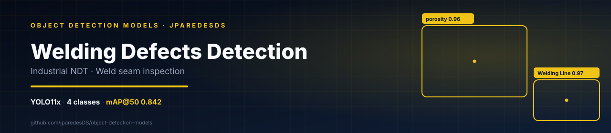
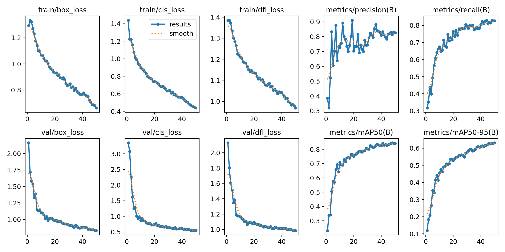
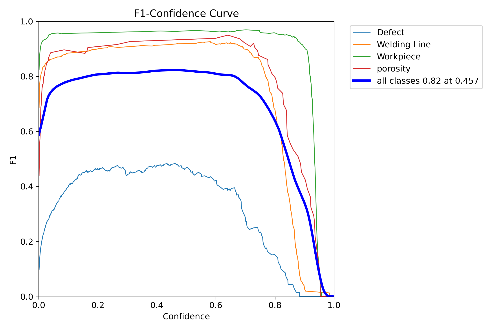
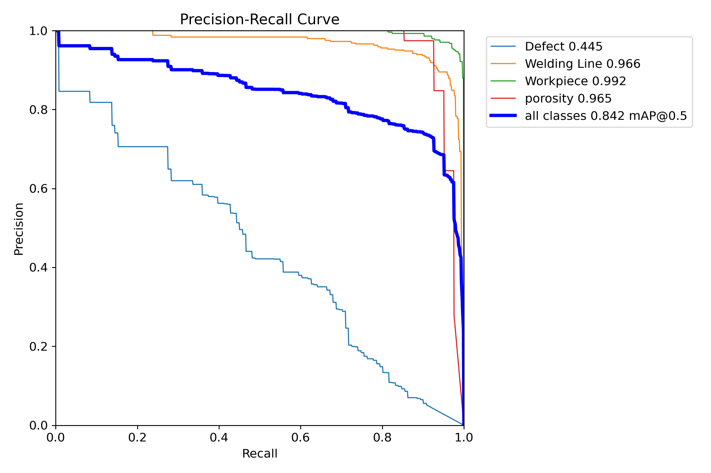
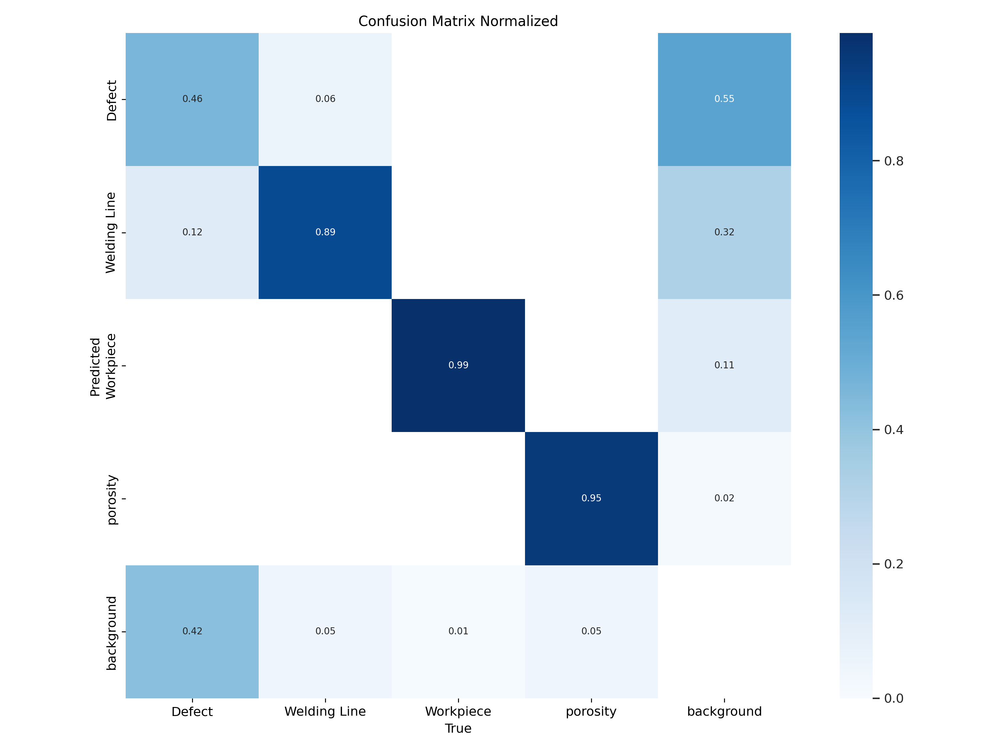
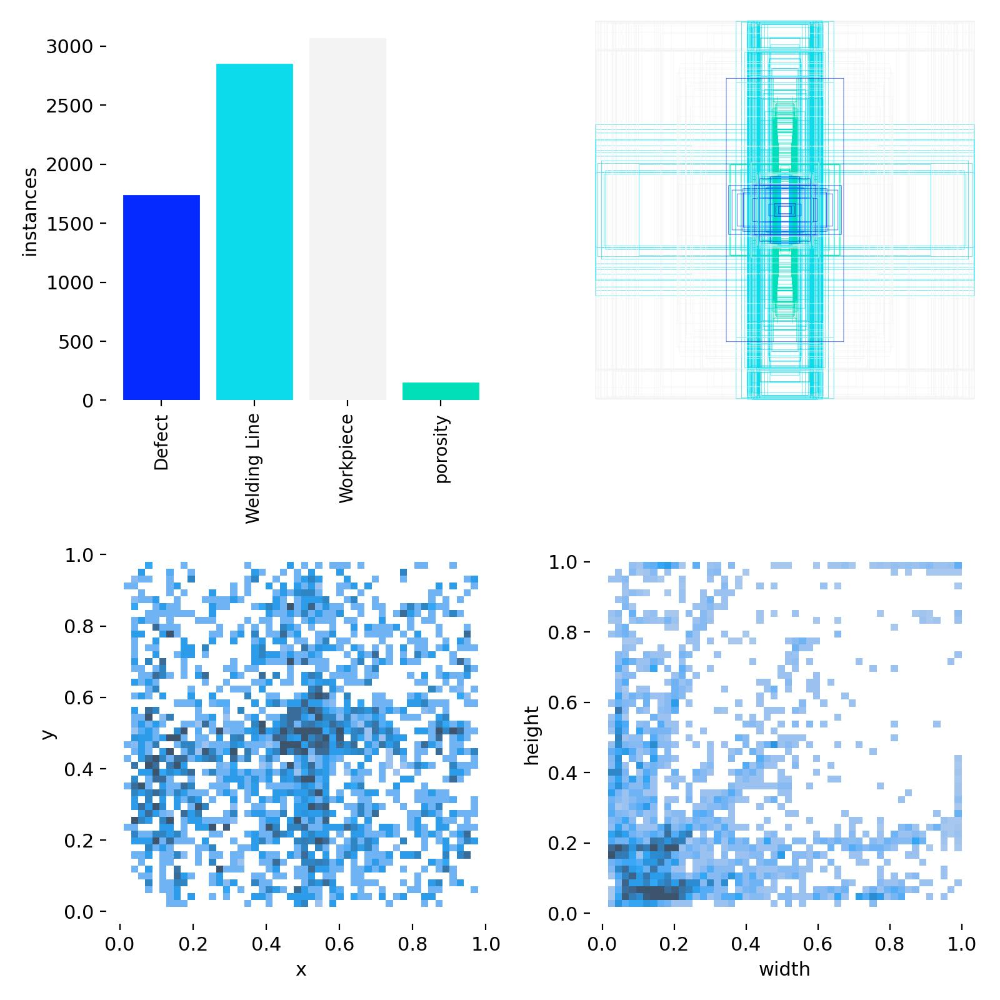

<div align="center">



# Welding Defects Detection

**A YOLO11x detector for weld seam inspection: defects, welding line, workpiece and porosity.**

[](https://github.com/ultralytics/ultralytics)
[](#results)
[](#class-labels)
[](https://huggingface.co/jparedesDS/welding-defects-detection)

[← Model zoo](../../README.md) · [Full catalog](../../docs/model-zoo.md) · [Training guide](../../docs/training-guide.md)

</div>

---

## At a glance

| Property | Value |
|---|---|
| **Task** | Weld seam inspection and defect localization |
| **Architecture** | YOLO11x |
| **Checkpoint** | `welding_defects_yolo11x.pt` |
| **Classes** | `Defect`, `Welding Line`, `Workpiece`, `porosity` |
| **Parameters** | 56.8 M |
| **GFLOPs** | 194.4 |
| **mAP@50** | **0.842** |
| **mAP@50-95** | **0.632** |
| **Validation split** | 116 images / 773 instances |
| **Training notebook** | [`notebooks/welding_defects_training.ipynb`](notebooks/welding_defects_training.ipynb) |
| **Model card** | [`jparedesDS/welding-defects-detection`](https://huggingface.co/jparedesDS/welding-defects-detection) |

The Hugging Face repository is gated: accept the conditions on the model card and authenticate with `hf auth login` before downloading.

> **Not a certified inspection system.** This model is a research prototype. Industrial acceptance still requires qualified inspectors, applicable standards (ISO 5817, ASME IX, AWS D1.1, etc.) and validated procedures.

## Overview

Weld inspection is a canonical industrial computer-vision problem: a human inspector looks at a seam, identifies the weld bead, the base workpiece and any surface defects, and decides whether the part is acceptable.

This project trains a YOLO11x detector to localize four elements at once — the welding line, the workpiece, porosity and a generic defect class — as a first step toward assisted or automated visual inspection. The coarse structure is easy to learn; the real difficulty is the long tail of defect morphologies.

The checkpoint is deliberately large (YOLO11x). In an industrial setting, inspection is often offline or semi-automated, so accuracy is worth more than the last few milliseconds of latency. For edge deployment, distill or prune the model after the dataset matures.

## Highlights

- **Four inspection classes** covering both context (`Workpiece`, `Welding Line`) and anomalies (`Defect`, `porosity`).
- **0.842 mAP@50** and **0.632 mAP@50-95** on the recorded validation split.
- **Strong structural localization**: 0.992 mAP@50 for `Workpiece` and 0.966 for `Welding Line`.
- **End-to-end notebook** with dataset preparation, training and evaluation.
- A realistic baseline for NDT research, including an honest look at the hardest class.

## Class labels

| ID | Label | Meaning |
|:---:|---|---|
| 0 | `Defect` | Generic weld defect |
| 1 | `Welding Line` | Weld bead / seam |
| 2 | `Workpiece` | Base metal part |
| 3 | `porosity` | Porosity |

## Results

| Class | Precision | Recall | mAP@50 | mAP@50-95 |
|---|---:|---:|---:|---:|
| **all** | **0.826** | **0.827** | **0.842** | **0.632** |
| `Defect` | 0.552 | 0.427 | 0.445 | 0.202 |
| `Welding Line` | 0.873 | 0.966 | 0.966 | 0.679 |
| `Workpiece` | 0.941 | 0.987 | 0.992 | 0.938 |
| `porosity` | 0.939 | 0.927 | 0.965 | 0.710 |

The model is reliable at localizing the macroscopic structure (workpiece and weld line) and at finding porosity. The generic `Defect` class is much harder: it groups cracks, undercuts, spatter and other anomalies with very different visual signatures. A production system should split `Defect` into specific defect types and collect more examples per type.

### Training results and curves

<p align="center">
  
  
</p>

<p align="center">
  
  
</p>

### Label distribution

<p align="center">
  
</p>

### Predictions

<p align="center">
  
</p>

## Quick start

```bash
hf download jparedesDS/welding-defects-detection \
  welding_defects_yolo11x.pt --local-dir weights
```

```python
from ultralytics import YOLO

model = YOLO("weights/welding_defects_yolo11x.pt")
results = model.predict("weld.jpg", conf=0.25, save=True, device=0)

for box in results[0].boxes:
    print(model.names[int(box.cls)], float(box.conf), box.xyxy.tolist())
```

### From detections to an inspection decision

The model outputs boxes, not acceptance criteria. A practical pipeline adds:

1. **Region filtering** — keep defects that fall on or near the detected `Welding Line`.
2. **Size measurement** — convert box dimensions to millimetres using a calibrated scale.
3. **Rule engine** — compare defect type and size against the applicable acceptance standard.
4. **Human review** — route borderline or low-confidence cases to a qualified inspector.

## Training notebook

[`notebooks/welding_defects_training.ipynb`](notebooks/welding_defects_training.ipynb) contains the dataset preparation, training and evaluation workflow used for this checkpoint, including the exact Ultralytics commands and the validation report.

General training instructions: [docs/training-guide.md](../../docs/training-guide.md).

## Dataset

- **Source:** weld inspection imagery with YOLO-format annotations.
- **Format:** YOLO boxes, four classes.
- **Class balance:** `Defect` is a catch-all and is the main source of error; `porosity` is better represented and much easier to learn.
- **Split size:** the validation set has 116 images. Re-evaluate on a larger, independent set before drawing conclusions.
- **Distribution:** dataset images are **not** distributed.
- **Quality control:** annotations were audited with [`check_labels.py`](../../tools/annotations/check_labels.py); augmentation follows [`augment_dataset.py`](../../tools/augmentation/augment_dataset.py).

## Roadmap

- Split `Defect` into cracks, undercuts, spatter and lack-of-fusion.
- Add pixel-level segmentation for defect sizing.
- Calibrate the capture rig (distance, angle, lighting) so box sizes are physically meaningful.
- Validate against the acceptance criteria of a specific standard and process.

## Related projects

- [Fluorescent Penetrant Inspection](../fluorescent-penetrant-inspection/) — another industrial NDT detector, focused on surface-breaking indications.
- [Full model zoo](../../docs/model-zoo.md) — every checkpoint and class list.
- [Training guide](../../docs/training-guide.md) — dataset layout, training and evaluation workflow.

## License

MIT. See the [repository license](../../LICENSE).
