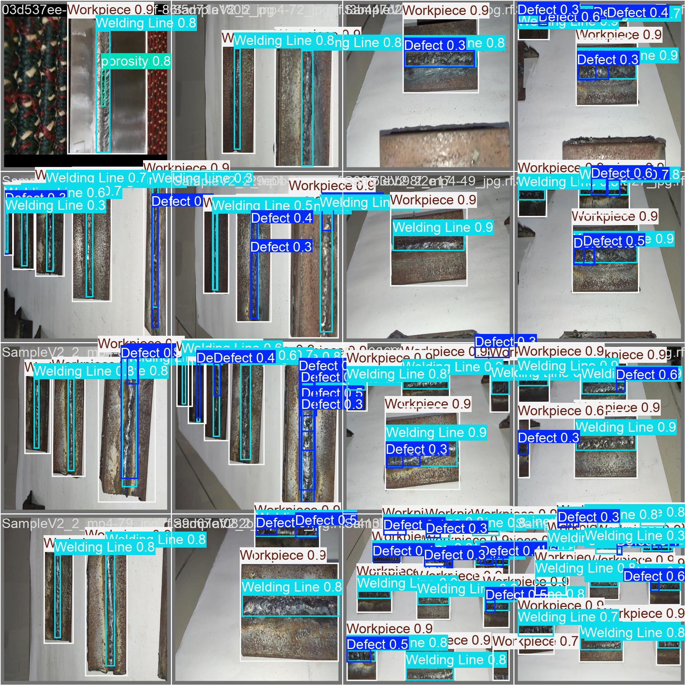

<div align="center">

# Welding Defects Detection

**A YOLO11x detector for weld seam inspection: defects, welding line, workpiece and porosity.**

[](https://github.com/ultralytics/ultralytics)
[](#results)
[](https://huggingface.co/jparedesDS/welding-defects-detection)

[← Back to the model zoo](../../README.md) · [Full catalog](../../docs/model-zoo.md)

</div>

---

## Overview

Weld inspection is a canonical industrial computer-vision problem: a human inspector looks at a seam, identifies the weld bead, the base workpiece and any surface defects, and decides whether the part is acceptable.

This project trains a YOLO11x detector to localize four elements at once — the welding line, the workpiece, porosity and a generic defect class — as a first step toward assisted or automated visual inspection.

> **Not a certified inspection system.** This model is a research prototype. Industrial acceptance still requires qualified inspectors, applicable standards (ISO 5817, ASME IX, AWS D1.1, etc.) and validated procedures.

## Model

| Property | Value |
|---|---|
| Architecture | YOLO11x |
| Weights | `welding_defects_yolo11x.pt` |
| Parameters | 56.8 M |
| GFLOPs | 194.4 |
| Classes | 4 |
| mAP@50 | **0.842** |
| mAP@50-95 | **0.632** |
| Validation split | 116 images / 773 instances |
| Hugging Face | [`jparedesDS/welding-defects-detection`](https://huggingface.co/jparedesDS/welding-defects-detection) |

The Hugging Face repository is gated (`auto`): access is granted after accepting the conditions on the model card.

## Class labels

| ID | Label | Meaning |
|:---:|---|---|
| 0 | `Defect` | Generic weld defect |
| 1 | `Welding Line` | Weld bead / seam |
| 2 | `Workpiece` | Base metal part |
| 3 | `porosity` | Porosity |

## Results

| Class | Precision | Recall | mAP@50 | mAP@50-95 |
|---|---:|---:|---:|---:|
| **all** | **0.826** | **0.827** | **0.842** | **0.632** |
| `Defect` | 0.552 | 0.427 | 0.445 | 0.202 |
| `Welding Line` | 0.873 | 0.966 | 0.966 | 0.679 |
| `Workpiece` | 0.941 | 0.987 | 0.992 | 0.938 |
| `porosity` | 0.939 | 0.927 | 0.965 | 0.710 |

The model is reliable at localizing the macroscopic structure (workpiece and weld line) and at finding porosity. The generic `Defect` class is much harder: it groups cracks, undercuts, spatter and other anomalies with very different visual signatures. A production system should split `Defect` into specific defect types and collect more examples per type.

### Training curves


### Confusion matrix


### Label distribution


### Predictions



## Quick start

```bash
hf download jparedesDS/welding-defects-detection \
  welding_defects_yolo11x.pt --local-dir weights
```

```python
from ultralytics import YOLO

model = YOLO("weights/welding_defects_yolo11x.pt")
results = model.predict("weld.jpg", conf=0.25, save=True, device=0)
```

## Training notebook

[`notebooks/welding_defects_training.ipynb`](notebooks/welding_defects_training.ipynb) contains the dataset preparation, training and evaluation workflow used for this checkpoint.

General training instructions: [docs/training-guide.md](../../docs/training-guide.md).

## Dataset notes

- Source: weld inspection imagery with YOLO-format annotations.
- Four classes; `Defect` is a catch-all and is the main source of error.
- Small validation split (116 images). Re-evaluate on a larger, independent set before drawing conclusions.
- Dataset images are not distributed.

## License

MIT. See the [repository license](../../LICENSE).
